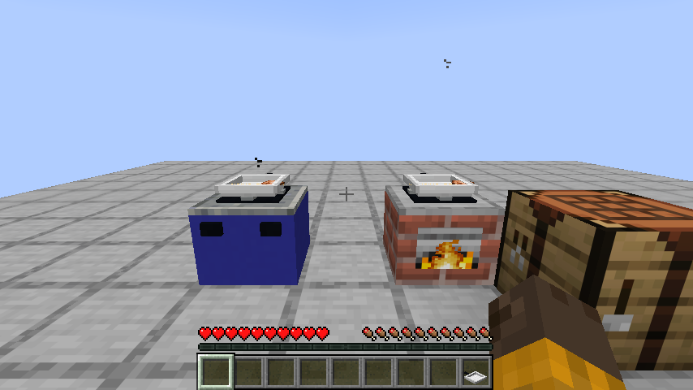
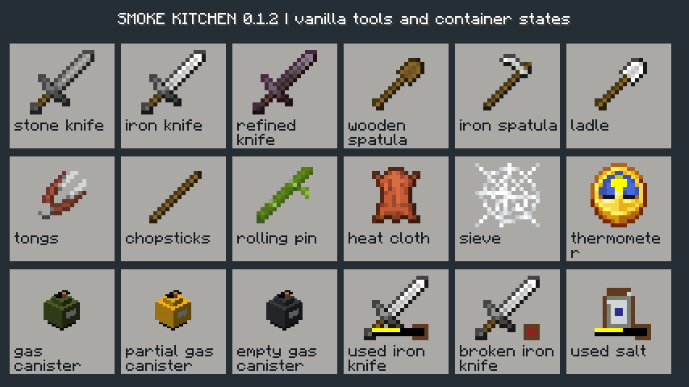

# 烟火厨房 · Smoke Kitchen

Minecraft Java **26.1.2 / Fabric** 的世界内做饭模组。通过砧板切配、锅具投料、调火和翻炒，把食材做成可以装盘分享的饭菜。

**当前版本：0.1.2 开发版。** 锅具嵌入低灶面，煤与燃气能把原版生肉变成真正熟食；修复管网供气，工具复用清楚的原版模型，气罐等资源有独立状态物品。完整设计仍在分阶段制作，切配与投料阶段、生物外观、建筑变体和经营内容仍未完成。见 [实现状态](docs/IMPLEMENTATION-STATUS.md)、[有限待办](docs/WORK-QUEUE.md) 和 [玩法设计](docs/DESIGN.md)。

## 当前玩法

- 在世界中切菜、投料、加水、调味、翻炒、装盘和搬锅。
- 食材分别计算熟度；锅具有余热，过热和疏于翻炒会烧焦。
- 陶锅、汤锅、炒锅、平底锅、蒸笼、烤盘、烤炉与两个独立灶眼的双眼灶。
- 29 道命名菜、通用菜肴、17 种作物、研磨压榨与发酵腌制。
- 基础生物、盐矿与 9 类探索建筑的生成框架。
- 冰柜、可关闭的保鲜、翻页食谱、中文提示和世界内食材显示。
- 独立的“烟火厨房”创造分类、7 种刷怪蛋、5 种熟肉/水产与熔炉/烟熏炉配方。
- 天然气开采机、储气罐、燃气管道与气灶；有限气源、断气停火、气罐搬运。

## 安装

[下载 0.1.2 开发版](https://github.com/newFanqie/smoke-kitchen/releases/tag/v0.1.2) · [本次更新与实测记录](docs/UPDATE-0.1.2.md)

1. 使用 Minecraft Java **26.1.2**、Fabric Loader **0.19.2** 或更高的兼容版本。
2. 安装对应版本的 Fabric API；本工程验证使用 **0.149.1+26.1.2**。
3. 移出所有旧版 `smoke-kitchen-*.jar`，把 `smoke-kitchen-0.1.2.jar` 放入该游戏实例的 `mods` 文件夹，勿使用 `-sources.jar`。保留 Fabric API。
4. 联机时服务器与客户端均安装本模组及 Fabric API。

实际客户端检查截图：




GitHub Actions 成功后，可从运行的 `smoke-kitchen-26.1.2` 附件下载构建。开发版先用于测试存档，尚未宣称通过最终画面、平衡与跨模组验收。

## 第一顿饭

1. 用黏土和圆石制作泥灶、陶锅、砧板和石厨刀。煤、木炭、木棍和谷壳可作燃料。
2. 持锅右键灶台，锅会嵌入灶面。持煤点击侧面自动点火；空手点侧面调火，点顶部投料。
3. 种植稻谷，在手磨脱壳获得米。手磨加入材料后，空手右键操作。
4. 陶锅加入一份米和水，煮熟后持碗或盘右键盛饭。
5. 炒锅中加入油、鸡蛋、米饭和葱，用锅铲翻炒，盐罐调味，再装盘。
6. 拿着厨师食谱右键，可翻页查看教程与菜谱。

普通右键投一份原料；潜行空手点锅具顶部取回单份食材，煮熟的原版鸡肉会变为真正的熟鸡肉。碗盘右键按菜谱分餐。砧板右键切四次，潜行持刀切换切法。锅具顶部空手切换支持的做法，灶台侧面空手调火。潜行持隔热布右键可搬运整锅，保留熟度、水、盖子和做法。煮、蒸、炖都需要水；最后加入的生肉仍要独立煮熟。

盐矿研磨成盐晶，16 份盐晶与空罐制成一罐盐。油菜籽与玻璃瓶在压榨机中制油。发酵和腌制加入材料后，空手右键密封。数值与操作会随开发继续调整。

## 天然气厨房

在新生成的区块地下 **0–48 层** 找到含气岩层，将开采机放在紧邻岩层的位置。用燃气管道连接开采机、储气罐和天然气灶，持锅右键嵌入气灶。空手点侧面切换关火/小火/中火/大火，正在燃烧时灶面有原版蓝色火焰动画并发光。也可把有气的便携罐直接接在气灶上；潜行空手点侧面拆罐。

岩层初始 2400 单位气，开采机会转移气量，不会无限生成。开采机和储气罐可用空燃气罐取出最多 600 单位气，也可用有气的罐补气。气罐只有满100%、使用中50%代表图标、空0%三个物品；实际余量通过提示和存档精确保留。管路检查只访问已加载的连接节点，最多 64 个；空气不再耗尽搜索预算。断开后，灶内余气用尽即停止供热。

设备保持立体方块模型；刀、铲、勺、夹子等工具直接继承原版模型，避免模糊雷同的细小体素图标。炉身封闭，燃烧面、火焰、烟雾和声音引用原版。全部 304 个物品及状态集中在“烟火厨房”创造分类，首次打开自动选中。运行时引用游戏内置素材，不捆绑原版贴图文件。原版及 Iris 实测组合和限制见本次更新说明。

## 构建与验证

需要 **JDK 25**。Windows 使用：

```powershell
.\gradlew.bat build runGametest
```

Linux/macOS 使用：

```sh
./gradlew build runGametest
```

输出在 `build/libs/`。单元测试位于 `src/test/`，真实游戏测试位于独立的 `src/gametest/`，测试模组不打包进正式 JAR。

可运行 `./gradlew runClienttest` 用实际客户端检查全部物品图标和灶台画面，截图位于 `build/clienttest/screenshots/`。该检查需要图形环境和首次下载官方资源，客户端测试代码不会打包进正式模组。

内容由 `tools/generate-content.mjs` 维护，使用 Node.js 重新生成并检查：

```sh
node tools/generate-content.mjs
node tools/validate-content.mjs
```

配置位于游戏实例的 `config/smoke-kitchen.json`。`spoilage` 控制变质，`freshDays` 和 `spoiledDays` 控制品质下降与不可食用的游戏日数。存档关闭不按现实时间补算，持续运行的服务器按游戏时间推进。

便携工具、游戏依赖、缓存和运行存档不上传到仓库。项目代码采用 MIT，素材来源见 [美术来源](art/ASSET-PROVENANCE.md)。本项目并非 Mojang 或 Microsoft 官方作品。
