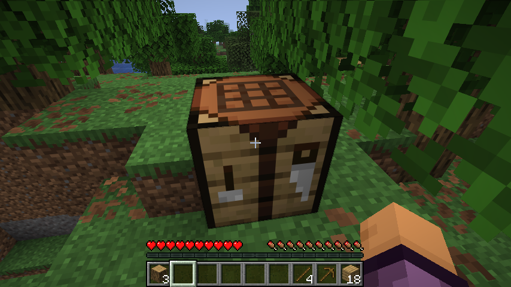
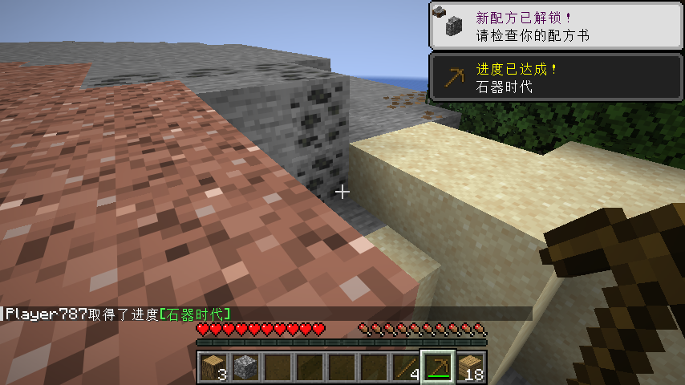

# 自然采集：历史探索记录

**此路线未完成，已由用户确认的新验收方式取代。** 用户2026-10-21明确允许代码提供基础材料、生成对应动物，合成制作和击杀掉落等由实际玩家操作。后续不再要求自动玩家跑图采集；制作链采用FirstMealFlowTest验证，不能把提供基础原料称为从零采集。

本轮真实进度已经继续到：采圆石、用已有木板垫高出天然沟壑，制作石镐、石斧、熔炉、石厨刀、手磨、砧板、石铲、木铲和木盖，实际采16份木材、拾起工作台，步行和游泳到种子1的河流附近，采20黏土球与5沙子。自动操作潜水未及时换气，测试玩家溺亡；没有回档或补发物资来伪造完成。用户随后调整范围，因此移除未完工的自然跑图入口，存档与运行日志仍保留在本地忽略目录。

以下为先前版本的探索说明与截图，仅作历史记录。

## 存档与限制

- 自然地形、种子1、Easy难度、原版生存、结构开启、作弊关闭。初始背包为空。
- 不使用传送、生成物品、放置测试资源、设置时间/天气、加速作物或修改熟度；世界使用正常游戏刻，正常保存/重开。
- 自动玩家通过正常挖掘、容器操作与移动输入行动。路径计算使用未加入世界的原版寻路实体作为探针，不生成世界里的生物、掉落或资源；只检查可见的资源表面。
- 本地存档在`build/clienttest/saves/Smoke Kitchen Natural First Meal`，断点在`build/clienttest/survival-first-meal.json`。两者均为忽略的运行产物，不随发布JAR分发。

## 已亲自运行的进度

出生点约(164,70,160)。实际手采橡木、合成木板/木棍，在(178,74,168)放置工作台。旧砧板配方抢占原版木镐，导致第一次实际制作失败；0.1.10消除冲突后，正常工作台成功制作真正木镐。在(180,72,148)附近露天石面实际采到第一块圆石。

0.1.10曾在取圆石的一格高差处暂停，随后本轮已继续至河流采黏土与沙子，最终发生前述溺亡。旧探索入口NaturalSurvivalProgressTest现已移除，不能再按旧说明选择它续跑；保留历史存档和日志用于追溯，新的制作验收由FirstMealFlowTest承担。

## 原先的下一步（已被新验收方式取代）

完成正常采石和工具、炉灶/锅具/刀/手磨/砧板合成，沿自然河岸取得黏土、野菜与种子，再完成盐、猪油和食材获取。记录真实燃料消耗、加工、切配、供热、调味、装碗食用及保存恢复。发现阻断时先修复，再继续同一存档；不能以已注册配方或测试提供原料替代此项验收。

[修复前，木镐材料错误产出砧板的实际截图](images/survival-recipe-conflict-before-0.1.10.png)。
