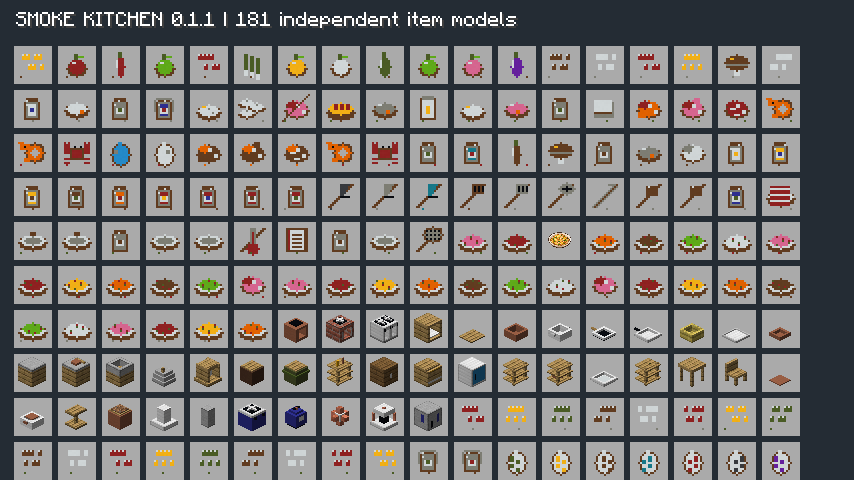
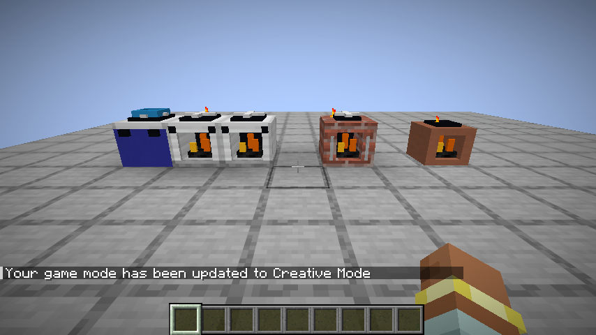

# 0.1.1：灶台、图标和燃气厨房

## 安装更新

游戏版本仍是 Minecraft Java 26.1.2、Fabric Loader 0.19.2，依赖 Fabric API 0.149.1+26.1.2。移出旧的 `smoke-kitchen-0.1.0.jar`，只安装 `smoke-kitchen-0.1.1.jar`，保留 Fabric API。

## 修复和新增

- 所有设备模型继承标准方块物品显示变换，修复物品栏只显示一个平面的问题。
- 泥灶使用陶土低炉身，砖灶使用砖砌炉膛，双眼灶使用金属台面和两个独立灶眼。炉膛能看见煤与火。
- 加煤自动点火，立即反馈剩余燃料。拿食材点灶台时，会明确说明应将食材放进上方锅具，不再误报缺煤。
- 增加天然气灶、开采机、管道、储气罐、含气岩层、空罐和满气罐；有限开采、守恒转移、断管停止供气。
- 181 个独立物品模型/图标；食材、工具、调料和刷怪蛋采用像素体素图标；设备保持立体方块图标。
- 17 种作物各有 8 阶段体素生长模型。
- 创造模式新增“烟火厨房”分类；增加鸭、鹅、野猪、河虾、河蟹、劫粮掠夺者、地窖蠹虫刷怪蛋。
- 增加熟鸭肉、熟鹅肉、熟野猪肉、熟河虾和熟河蟹，以及熔炉/烟熏炉配方。
- 食谱增加燃料、天然气和创造模式说明。

## 天然气操作

在新生成区块的地下 0–48 层寻找含气岩层，开采机必须紧贴岩层。管道连接开采机、储气罐和气灶，空手右键气灶调火，锅放在气灶上。每块岩层有 2400 单位气，便携罐容量 600 单位。开采机/储气罐可用空罐取气、满罐补气。管路最多检查 64 个已加载位置。

## 仍在制作

动物和怪物仍使用原版渲染模型与皮肤，图标和刷怪蛋的加入不代表独立生物外观已经完成。建筑独立蓝图、村民职业、品质订单和宴席进度仍在后续设计范围内。图标为原创可编辑体素模型，材质在运行时引用游戏内置贴图，未声称每个图标都生成了独立 PNG。

## 验证

通过资源与图标唯一性检查、10 项烹饪单元测试、11 项自定义服务端游戏测试及 Fabric 内置空测试、实际客户端截图检查。客户端成功进入测试世界；181 个物品图标和灶台炉膛均已使用实际游戏渲染器检查，没有模组模型或贴图缺失警告。尚未完成双客户端联机和长期平衡验收。

