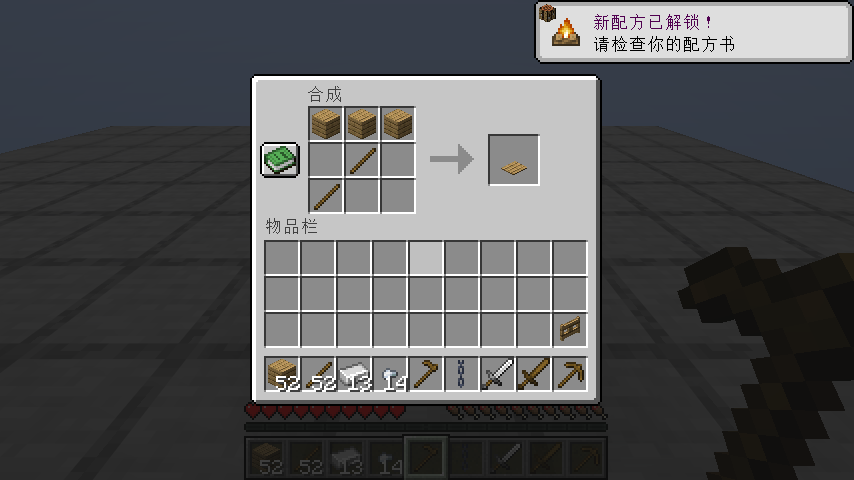
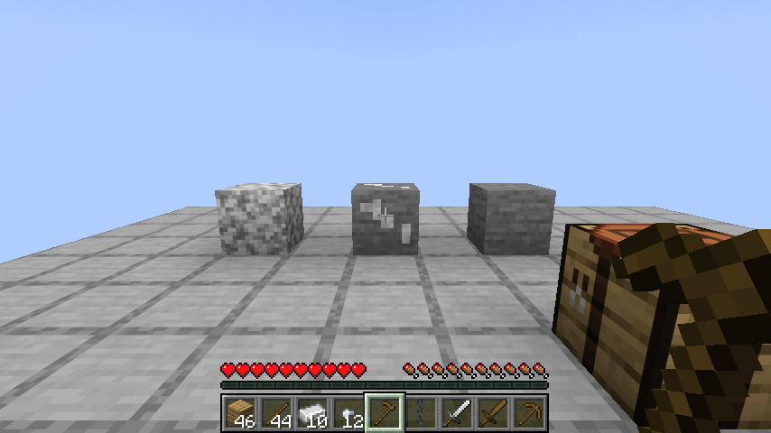
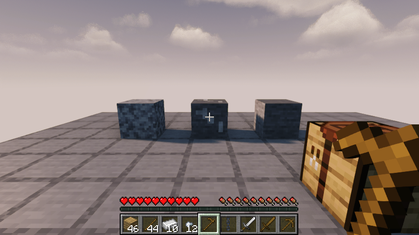
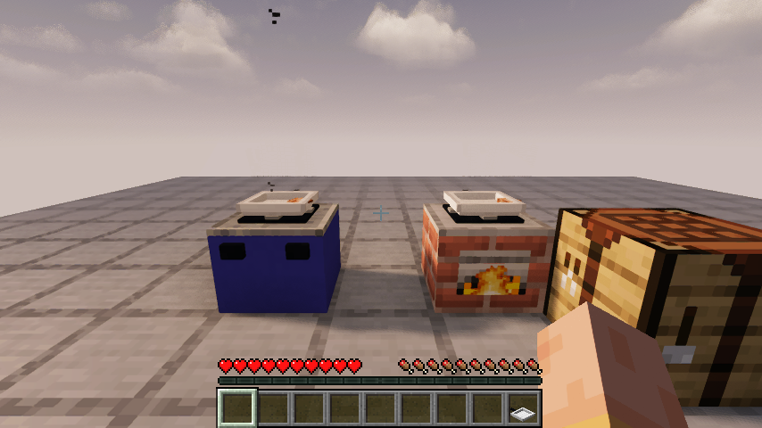

# 0.1.10：恢复原版合成与配方发现

Minecraft Java 26.1.2 / Fabric Loader 0.19.2 / Fabric API 0.149.1+26.1.2。

## 实际生存发现的问题

从空背包新建自然生存世界，用手采木、制作工作台后，原版木镐的材料竟然合成了砧板。这会阻断后续采石和厨房制作。继续检查全部已加载的厨房合成与原版配方，发现了6处冲突，已分别改为有区别的有序摆法，材料成本保持不变。

| 恢复正常的原版配方 | 调整摆法的厨房物品 | 厨房配方材料 |
| --- | --- | --- |
| 木镐 | 砧板 | 橡木木板3、木棍2 |
| 木剑 | 木盖 | 橡木木板2、木棍1 |
| 铁剑 | 汤勺 | 铁锭2、木棍1 |
| 铁锁链 | 夹子 | 铁锭1、铁粒2 |
| 木锄 | 餐桌 | 橡木木板2、木棍2 |
| 橡木栅栏门 | 碗盘架 | 橡木木板2、木棍4 |

砧板最下方的木棍移到左侧，与木镐的直柄分开；其他五种改用独立的摆法。已有设备、工具和存档物品不变。

## 原版配方书与盐矿

82条厨房工作台/背包合成配方加入原版材料发现机制。取得对应基础材料后，普通绿色配方书按钮会收录配方，不再需要在文档中猜摆法。旧存档正常拾取或变动相应材料也可触发解锁。厨房的手动研磨、发酵和实际做菜仍通过设备与厨师食谱引导。

盐矿改为原版石头底色上的白色晶脉，六面和背包模型一致，引用原版石头/方解石材质。与普通石头、闪长岩并排时可以区分；挖掘掉落和生成规则保持原来的有限矿物路线。

## 验证范围

74项单元测试、63项自定义服务端游戏测试和1项原版空测试通过。新增回归在实际加载的配方管理器中，双向检查厨房与原版常规合成示例的匹配，保留木镐/砧板专门正例。特殊原版配方没有普通材料布局时跳过，不宣称覆盖第三方模组与任意数据包。

原版客户端和Iris 1.11.4 + Sodium 0.9.2 + MakeUp Ultra Fast 9.6分别完成：工作台正常合成6种原版物品与6种调整后的厨房物品；检查6种厨房配方随材料解锁；退出重开后12种实际成品数量正确；盐矿、石头和闪长岩并排画面检查。运行断言确认Iris光影包实际启用，48项原版贴图与30项模型父项引用均在本游戏版本中存在。

同时回归实际玩家挖盐矿、手磨装盐、海水蒸发、压榨、小火炼油、调料与水壶用量、稻谷脱壳、熟米回锅及保存重开，以及全部309条目的创造分类、平底锅合成、低灶面实际做熟并取出鸡肉、气罐和管路供气。本版重复运行以上三组客户端流程，使用正常游戏刻；其他未改动客户端流程未逐一重跑。提供原材料与设备的回归场景不计作无作弊生存。

详细结果见[验证记录](verification/0.1.10.json)。无作弊第一餐仍未完成，进度与下一步见[NATURAL-SURVIVAL.md](NATURAL-SURVIVAL.md)。自然存档已从空背包手采木材、制作工作台和真正的木镐，并实际挖到圆石；这只算起步阶段，不能替代盐、油、食材、做熟、食用的完整验收。

## 发布核对

本地已完成验证，上传后的源码提交、下载大小与哈希核对在发布后补记。安装时移出旧版JAR，使用smoke-kitchen-0.1.10.jar并保留对应Fabric API。
