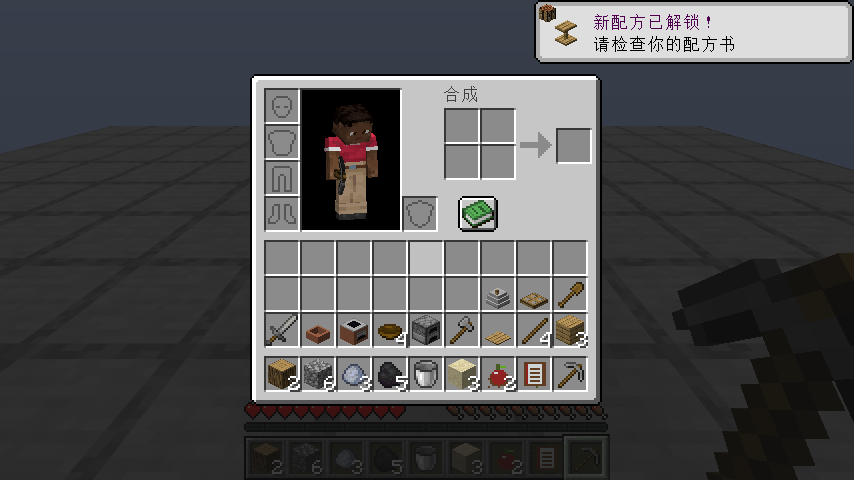
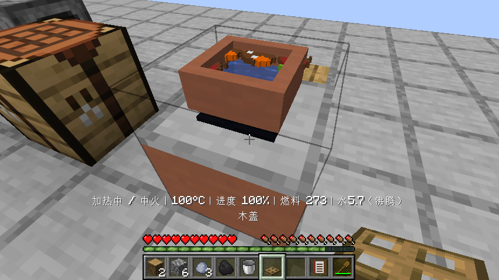
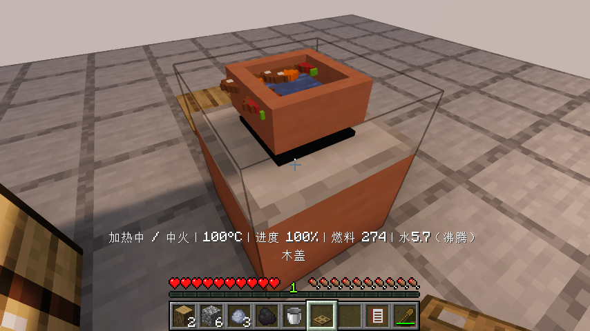
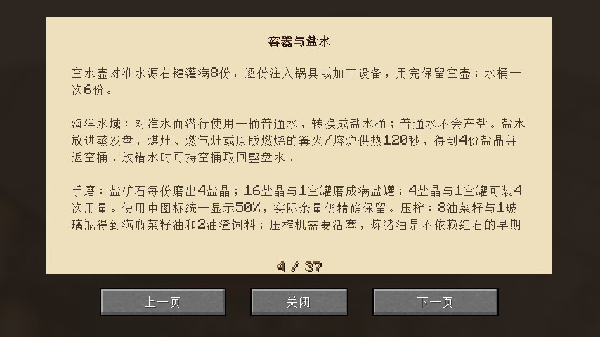

# 0.1.11：小批盐罐与完整制作第一餐

Minecraft Java 26.1.2 / Fabric Loader 0.19.2 / Fabric API 0.149.1+26.1.2。

## 少量盐也能使用

手磨加入4份盐晶和1个空罐，可以装成实际4次用量的盐罐。不足4份时不会吞材料；16份盐晶仍优先装成16次用量的满罐。一次海水蒸发得到的4份盐晶可以立即用于做菜，不必再攒四批海盐。

复用已有“盐罐（50%）”使用中物品，50%只是所有中间状态共用的代表图标，提示和存档保留真正余量。4次调味后返还原来的空罐，不新增99个状态物品。食谱书的获取页与容器页同步说明。

## 实际制作第一餐

按用户本轮确认，允许代码提供基础原料、生成对应动物和矿源，跳过自动跑图采集。新的FirstMealFlowTest只提供8原木、32圆石、12黏土球、5煤、3铁锭、3沙子、2番茄，以及制作食谱书的原版书和小麦种子；提供平地、水源、盐矿、两只鸭和一头猪。动物关闭AI以固定场景，仍由测试玩家实际攻击击杀、走过去拾取真实掉落。

以下流程通过正常玩家制作格、容器点击、物品使用和攻击执行，使用正常游戏刻：

1. 木板、木棍、工作台、石镐、石斧、熔炉、水桶、碗、泥灶、陶锅、石厨刀、木铲、木盖、手磨、砧板和食谱书全部实际合成，设备实际放置。
2. 熔炉消耗实际煤把3沙子烧成玻璃，再实际合成4空罐。石镐挖盐矿、手磨研磨、装成4次盐罐。
3. 实际杀两鸭一猪，取得两份鸭肉、猪肉及一份动物脂。脂肪在冷锅小火熬透，装出4次用量猪油和1份油渣。
4. 两份鸭肉、两份番茄各自在砧板切丁。用合成的水桶真正取水，加盐、猪油和食材，加盖中火、实际翻动，等待食材各自熟透。
5. 未熟时持碗不会提前产菜或吞碗。熟透后开盖查看真实锅内食物，盛出家常炖汤并实际食用，返碗；关闭灶火，保存退出。
6. 重开世界后剩余一份汤、水量、有限燃料和两罐各3次余量均保持，实际盛出最后一份，锅内不会重复返生料。用亲手制作的食谱书打开并翻到小批盐说明。

食用测试将饥饿值设为8以允许吃饭，之后的饱食恢复和碗回收来自实际食用。这是明确提供基础原料的制作验收，不宣称空背包自然探索已经完成。旧自然采集的进度与未完成原因保留在[NATURAL-SURVIVAL.md](NATURAL-SURVIVAL.md)。

## 验证与范围

74项单元测试、64项自定义服务端游戏测试及1项原版空测试通过。新增服务端用例检查不足4份不吞料、装罐的精确4/16用量、4次实际调味和空罐返还；既有16份满罐路线回归。

原版客户端和Iris 1.11.4 + Sodium 0.9.2 + MakeUp Ultra Fast 9.6分别执行FirstMealFlowTest、AcquisitionFlowTest和StapleFlowTest。除本版完整制作链，还回归矿盐/海盐、压榨、猪油、水壶、脱壳、米饭回锅、面食和蒸烤、保存恢复。Iris检查断言光影包实际启用，截图逐项目视核对。其他既有客户端测试入口保留，本版未全部重复运行，不宣称兼容任意光影包。

详细范围、日志和发布摘要见[验证记录](verification/0.1.11.json)。设计中的酱油预煮过滤、设备功能、美术、独立建筑与经营等仍见[有限待办](WORK-QUEUE.md)，未标为完成。

## 本版结束后暂停

按用户要求，只完成并发布0.1.11，再暂停本聊天自动续做。保留进度和待办，等用户说“继续”时再恢复，不启动下一版。
