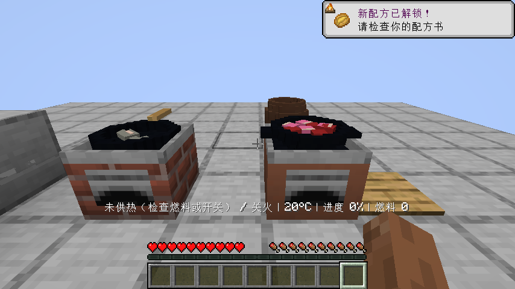
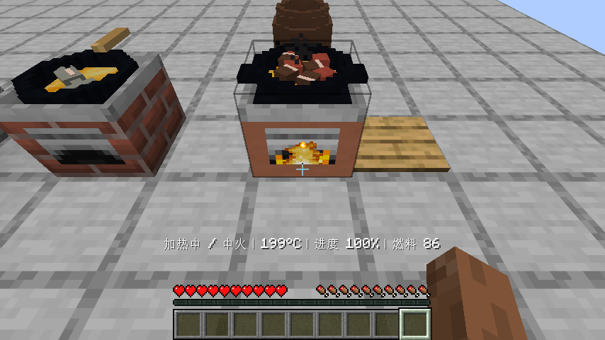
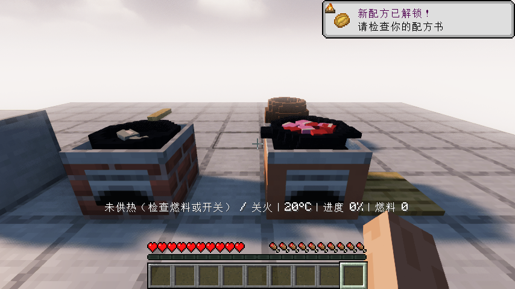
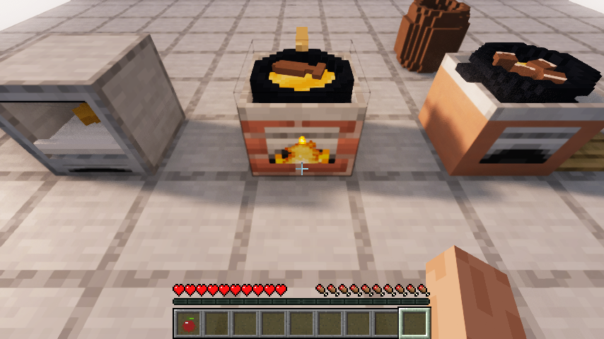
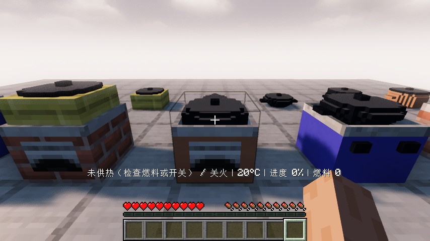
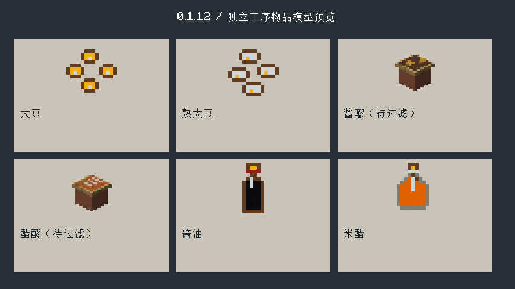
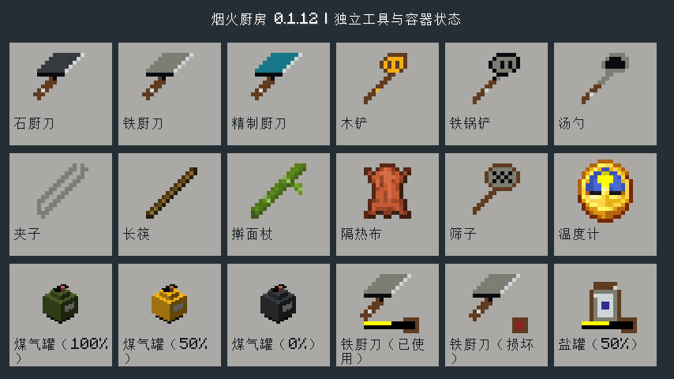

# 0.1.12：贴合锅具、锅内切配和分阶段外观、熟豆酿制与过滤

Minecraft Java 26.1.2 / Fabric Loader 0.19.2 / Fabric API 0.149.1+26.1.2。

## 分步做酱油和米醋

大豆现在可以加水入锅煮熟或放蒸笼加盖蒸熟，得到独立的熟大豆物品。干锅不会让生豆增长熟度；生豆不能直接代替熟豆发酵。

| 工序 | 材料与操作 | 产物 |
| --- | --- | --- |
| 酱油发酵 | 熟大豆4、面粉2、盐2次、发酵引子1、空调料罐1、水至少1份，发酵缸密封2400游戏秒 | 酱醪1、保留引子1 |
| 米醋发酵 | 熟米饭4、醋引子1、空罐1、水至少1份，同样密封2400游戏秒 | 醋醪1、保留醋引子1 |
| 过滤 | 调理台放对应醪液1和玻璃瓶1，持筛子右键 | 对应8次用量调料1瓶、返空调料罐1 |

发酵完成的醪液有各自物品和模型，仍需过滤；空手搅拌不能直接产出瓶装调料。筛子使用128次，具有完整、已使用和损坏状态，可用线修复。筛子在空台上用过后再加料，不能让后续空手操作冒充过滤；缺少承接瓶或空间时保留材料。

缸盖密封时不能取出材料，先空手开盖再潜行空手取回。旧的面团发酵也使用同一开盖操作。盐按实际用量扣除，熟米饭按是否真正带碗返还容器；散装熟饭不凭空返碗。原来已酿好的酱油和米醋仍可使用，新批次改为分步工艺。

厨师食谱新增分步页面，发酵缸和调理台提供缺料、开盖及筛子提示，准星看向设备会自动显示实际进度或下一步，不必为了检查进度反复开盖；关闭详细提示的选项仍生效。自动验收另显示等待阶段和百分比，避免静止视角看起来像卡住。熟豆复用原版可可豆图标，醪液模型用原版陶土、木材和可见豆粒/米粒区分。调整生成顺序，保持已有物品模型不因新条目的索引变化而重绘。

## 本版实际操作验收

FermentationFlowTest只给明确的配方基础材料：木板、木棍、圆石、黏土球、陶瓦、线、平滑石头、玻璃、铁、煤、大豆、稻谷、小麦、菌菇、糖、苹果、盐晶、土豆，以及书和小麦种子。不提供工具、设备、熟豆、熟米饭、引子、醪液或最终调料。平地、原版2×2可再生水池和站位传送是隔离测试场景。

实际在制作格合成缸、筛子、调理台、手磨、灶锅、盖子、容器和食谱书；用煤加热，干豆负例后加水真正煮熟，稻谷实际脱壳并煮饭，小麦研磨、盐晶装罐。用亲手煮的饭培养两种第一代引子；发酵中途退出重开，再用真正熟豆和熟饭分别酿制醪液，取出、过滤、返罐。最终用亲手酿好的酱油和米醋调味实际煮土豆，装碗食用并保存重开，验证两瓶各剩7次用量。

煮豆、做饭与玩家操作使用正常刻速。只有两段长发酵等待在隔离世界使用原版`tick rate 200`，并用仅存在于客户端测试模组中的时钟适配让客户端跟随200刻速（Fabric测试框架将服务器同步到客户端）；结束恢复20。时钟适配不会进入正式JAR。培养和酿制仍执行全部真实服务端游戏刻，不设置work、不改时间戳或配方时长、不发产物。两种第一代引子各等待1200游戏秒，两缸醪液各等待2400游戏秒并行执行。该测试不宣称现实等待了60分钟，也不宣称自然采集从零完成。食用前将饥饿值设为8以允许测试实际进食。

服务端测试另覆盖满48000刻发酵前不提前产物、生豆拒绝、未过滤不能直接得瓶、密封不能取料、保存醪液、筛子状态、缺空间全部回滚以及容器回收。

原版与Iris的完整结果、截图及发布摘要记录于verification/0.1.12.json。本版不把豆腐的浸泡、磨浆、煮浆、点制和压模标为完成；后续有限待办见WORK-QUEUE.md。用户已要求继续，自动续做已恢复。

## 世界内外观与接触修复

锅具不再叠加原版固定物品的缩放后靠经验抬高。灶面是13/16高，中心有实际凹槽，普通锅底落在11/16高的支撑面；宽烤盘由灶面边框承托。碰撞/选中范围使用相同尺寸，锅盖按各自锅沿高度放置。平底锅把手避开台面和锅盖。四种灶台与七类锅具的28组实体积交叉检查，以及七种锅盖的贴合/把手检查通过，允许接触而拒绝正体积穿插；这只是几何审计，另有实际客户端摆放与目视检查。

炒锅、平底锅、陶锅、铁汤锅、腌制/发酵缸使用原创阶梯圆形模型。关闭的锅盖和缸盖挡住食材与液面；去掉缸体上穿出的平铺世界文字，保留准星提示。七类锅具分别在灶上和地面实际放置、加盖并截图。

锅内食材使用稳定的散落位置，切块/片/丝/末有对应几何形态。实际锅铲操作让位置和朝向移动后落稳，夹子翻面动作保留。外观读取每份真实熟度及焦化：生、变色、上色、熟、焦化；水煮使用较浅的熟色。砧板上回放已切材料也能看见切块。常用肉鱼、根茎、红色蔬果、绿叶、米蛋和面食先采用七类简化模型，未覆盖或无法分类的内容仍显示实际物品；并未把全部独立菜肴/食材美术标为完成。

第一批独立像素图标共12个基础物品：三把厨刀、木/铁锅铲、汤勺、夹子、筛子、生/熟大豆、酱油、米醋。对应使用中/损坏状态继续引用自己的基础造型。小像素轮廓与原版协调，不再把刀铲直接画成原版剑锹。模型由可编辑像素行和方块几何生成，部分表面颜色仍引用原版运行时材质；全部原创贴图和动物美术仍在后续清单中。

CookingAppearanceTest在原版和实际启用Iris分别执行：真正持刀切肉与番茄、摆入锅内、冷锅翻动观察位置变化、加煤与油炒熟、取一份切料、鳕鱼部分变色后夹子翻面、煎熟取出真正熟鳕鱼、再投鱼并补煤故意烧焦，以及烤土豆和关闭重开存档。等待与熟度全部按真实游戏刻推进，未发熟食或设置熟度。这是视觉/交互测试场景，设备和工具直接提供，不冒充上述独立的基础材料合成验收链。

本版74项单元测试、68项自定义服务端游戏测试及1项原版空测试通过。原版/Iris先完成四组工艺流程，再完成烹饪外观、煤气/合成/分类、引导图标回归，最后补验七类冷锅与盖子。客户端完整测试清单为15个入口，不声称本版将15项全部重复运行；具体本版执行范围见verification/0.1.12.json。

## 当前构建的实际画面

工艺阶段的发酵截图早于本版后续美术调整，保留实际制作证据；以上锅盖/工具最终截图来自后续相应检查。生成的概念样例不作为实机证据。用户提供的八个参考JAR仅只读分析，清单、模型与像素设计观察见[厨房模组参考](REFERENCE-KITCHEN-MODS.md)，未复制原素材到正式模组。

## 发布核对

[0.1.12开发版](https://github.com/newFanqie/smoke-kitchen/releases/tag/v0.1.12)已发布，实际下载920727字节JAR并核对SHA256：`6c77a6ea103a93491684b1d2cf65d43c4198335ac93ac95299796ed8b4066b33`。源码提交为`4615ed4b21134454cdbe65a7818aee9541c177e4`，[对应自动构建与游戏测试](https://github.com/newFanqie/smoke-kitchen/actions/runs/39567285841)通过。详情见verification/0.1.12.json。
