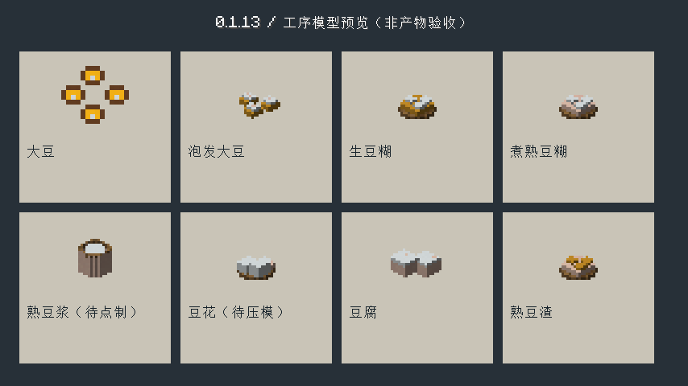
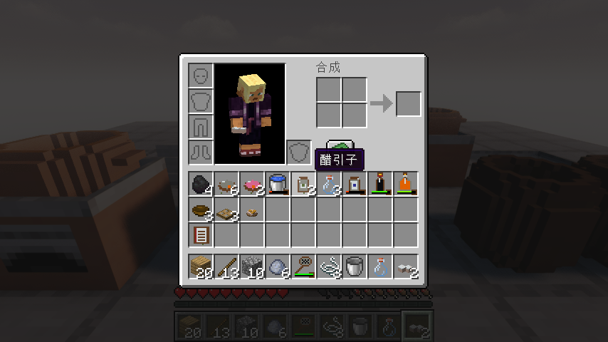
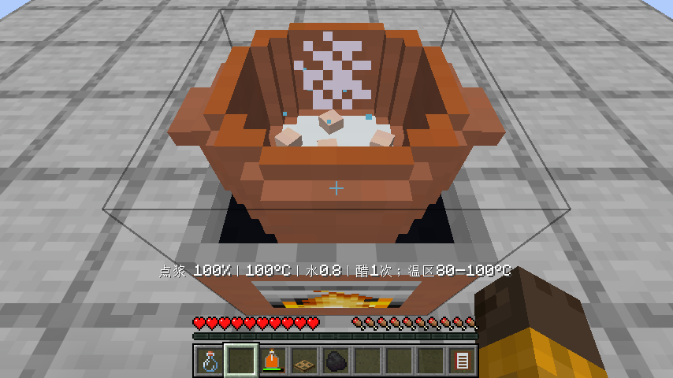
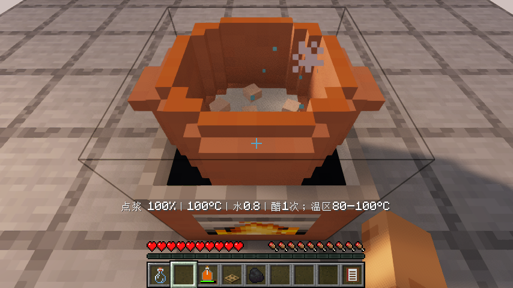
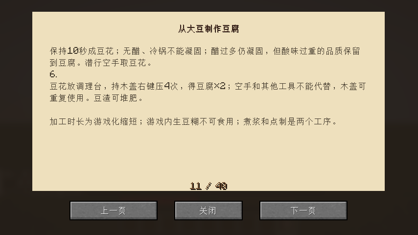

# 0.1.13：从大豆到豆腐

本版已完成原版与实际启用Iris的制作及画面验收。下载与源码核对见文末。

原来“大豆、醋、水搅拌就出豆腐”的路线移除，改为沿既有厨房设备逐步制作。

| 工序 | 实际操作与产物 |
| --- | --- |
| 浸泡 | 发酵缸只放4份大豆和至少1份水，空手盖缸，经过120游戏秒；开盖取出4份泡发大豆。混入酿酱油等其他材料不会误触浸泡 |
| 湿磨 | 手磨放4份泡发豆和1份水，空手操作2次，得到1批生豆糊 |
| 煮浆 | 豆糊入陶锅或汤锅，另加水并正常供热，到100%后潜行空手取出煮熟豆糊；干锅不能煮熟 |
| 筛浆 | 调理台放熟豆糊和1空调料罐，持筛子过滤，得到1罐熟豆浆和1份熟豆渣；生豆糊不能代替 |
| 点制 | 熟豆浆倒回锅，返原空罐并带入1份液量；加1次米醋，80–100°C温热10游戏秒成豆花，潜行空手取出。无醋、冷锅或混入其他食材不凝固；醋过多仍会凝固，但压模不能抹掉酸味过重的品质惩罚 |
| 压模 | 豆花放调理台，持木盖右键4次，得到2份豆腐；木盖保留。空手或筛子反复操作不能预付压模进度 |

这些时间和用量是游戏内简化值。完整工艺仍使用原有发酵缸、手磨、锅、筛子、调理台和木盖，没有新增单用途大型机器。豆渣可投入厨余桶。

工艺依据参考[醋类凝固剂对豆腐质地影响的原始研究](https://riunet.upv.es/server/api/core/bitstreams/465807ca-e51c-4d87-a9c2-78b0651f431d/content)：泡豆、研磨、加热、凝固与压制有不同作用，酸的种类和配比会影响凝固与质地。这里的80–100°C操作窗口、10游戏秒和“多加一份即降品质”属于游戏规则，不是论文中的精确实验配方。

泡发豆、生/熟豆糊、熟豆浆、豆花、豆渣和豆腐有独立原创方块模型；采用清晰块面与阶梯轮廓，运行时引用原版材质。锅内豆浆显示为液面，逐渐出现凝块，盖好时隐藏内容。原料熟透与表面煎黄分别处理：已经可食的豆腐放进冷锅仍为浅色，受干热后才开始变黄，湿煮不画成煎炸色。未加入第三方模组的模型或贴图。

豆浆不能倒在没有锅的灶眼、烤炉或烤盘上。散装豆浆取出、回投和打破锅具时保留其实际剩余液量，不补回蒸发水；原罐只返还一次。

翻页食谱新增完整豆腐步骤，中间物品提示能找到工艺路线；准星提示显示浸泡、凝固和压模进度。

## 验证记录

- 77项单元测试和74项总游戏测试通过，包含泡豆真实计时、防跳工序、酸与温度、四次压模、部分进度序列化、承接罐与散装液量守恒。
- 原版及实际启用Iris 1.11.4、Sodium 0.9.2、MakeUp Ultra Fast 9.6：基础材料实际合成厨房、首代培养/酿醋、泡豆/湿磨/煮浆/筛浆/点制/压模，得到2豆腐、实际吃1份；多次真实退出重开保留部分浸泡、部分凝固、部分压模和最终余下的1豆腐、1豆渣、3空罐与6次米醋。
- 整链仅提供基础原料、可再生水池和定位传送；饥饿在食用前调为8以检查恢复。酿醋长等待在隔离测试以200刻速和客户端时钟适配运行全部游戏刻，不改加工进度；豆腐工序按正常游戏刻执行。视觉夹具允许直接提供中间品，仅用于液面/凝块/盖锅画面，明确不计作基础原料制作证据。
- 本版按依赖运行TofuFlowTest（内含完整FermentationFlowTest）、TofuGuideTest和KitchenVisualTest，并在两种渲染器补验最终修正的教程/画面；未声称重跑完整清单的全部17项。测试时钟与测试类不进入正式JAR。
- 28组锅灶支撑与7种盖子接触几何检查通过；原版资源引用52种材质、22个父模型，缺失0。

后续仍有菜谱逐道完整制作、散装调味/品质继承、独立动物美术、农牧生态、独立建筑、设备功能、经营、双客户端并发和区块卸载保鲜等有限待办。豆腐工艺不代表整个设计稿已完成。

## 实际截图

## 发布核对

JAR：952809字节，本地SHA256 `a0fc30d89f73c47c636cc6d03f8bbb507098360788effe039123366a75d2ba58`。本地文件、GitHub服务器摘要与实际重新下载的JAR三者一致，[结构化验证记录](verification/0.1.13.json)。

[下载0.1.13开发版](https://github.com/newFanqie/smoke-kitchen/releases/tag/v0.1.13)。源码提交 `e81d14fa2f5b6cfb06e6b3a01c6baf8888a8c05b` 的[自动构建与游戏测试](https://github.com/newFanqie/smoke-kitchen/actions/runs/39590399449)已通过。
