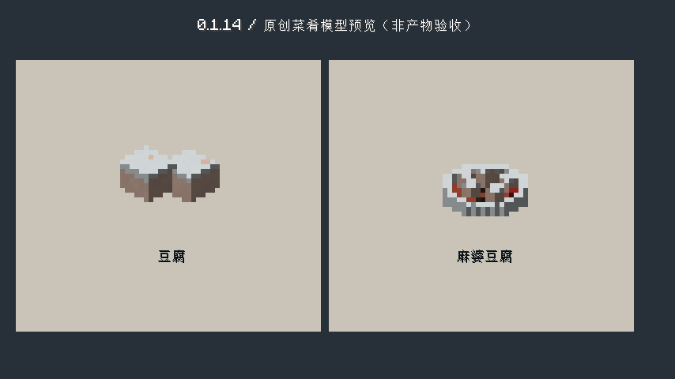
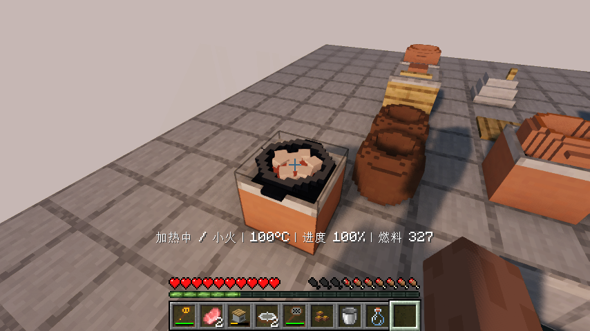
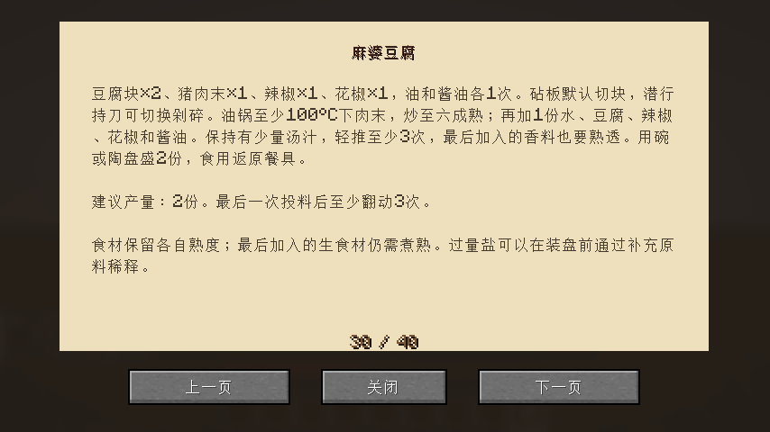

# 0.1.14：麻婆豆腐制作与原创装盘

本版已完成原版与实际启用Iris的客户端制作和画面检查；开发JAR的下载摘要与源码构建结果另列于验证记录。

麻婆豆腐补齐设计表中的花椒：豆腐2份、猪肉末1份、辣椒1份、花椒1份，油和酱油各1次。砧板切豆腐块并剁肉；先将有油的锅预热到100°C，再下肉末，至少炒到六成熟后加1份水和豆腐。添辣椒、花椒和酱油，保留少量汤汁，投料结束轻推至少3次，全部熟透才装盘。两份菜都可以用碗或陶盘盛，食用返回原餐具。

锅内有油、酱油与豆腐时，实际辣椒加热到三成开始显示红汤；花椒用4粒小颗粒表现，加盖隐藏汤面和食材。

新增原创阶梯圆盘模型，用浅色豆腐块、红色汤汁、棕色肉末和零星香料区分食物；使用清楚的体素轮廓与原版色块材质，没有复制参考模组资源。这是一个代表性成菜样例，其余菜肴仍按有限待办逐项优化。

## 本版实际验收范围

MapoFlowTest 接续真实首代培养、酿酱油/醋与豆腐六工序，保留实际做出的两份豆腐；只提供基础建材、新鲜香料与活猪。实际合成斧、刀、砧板、炒锅、灶和陶盘，攻击猪取得肉与生脂肪、小火炼猪油、切配、热油下肉、加水下豆腐与香料、轻推、供热做熟、装盘食用、返回陶盘，并检查制作中及剩余菜肴的保存重开。不直接给予豆腐、肉、油、酱油或成菜，不修改熟度。测试中允许位置传送，长发酵仍运行全部游戏刻，以隔离测试时钟加速。

另以 MapoGuideTest 实际合成和翻阅食谱；放大的模型对照页明确标注为预览，不是原料生产证据。

## 验收结果

- 构建、77项单元和74项总游戏测试通过。
- 原版完整客户端流程及最终模型/汤色/食谱补验已通过，选定截图已目视核对。
- Iris 1.11.4 / Sodium 0.9.2 实际启用MakeUp Ultra Fast 9.6，同一完整制作、实际食用和多次保存恢复通过，选定最终截图已目视核对。
- 原版完整制作使用早期渲染，最终汤色/花椒/模型有短画面补验；Iris完整制作使用最终渲染。完整19项测试清单已恢复，本版运行两组及其继承依赖，不声称19项全部重跑。
- 最终JAR、下载摘要与精确源码CI见[验证记录](verification/0.1.14.json)。

其余设备、独立动物外观、建筑、经营、多人和区块保鲜仍在WORK-QUEUE中；本版不宣称整个设计稿已完成。

## 客户端截图

完整制作截图保存在screenshots/0.1.14/vanilla与iris。独立汤色夹具使用给予的中间品，只用于检查红汤、花椒颗粒和盖锅隐藏，不作为基础原料制作证据。
