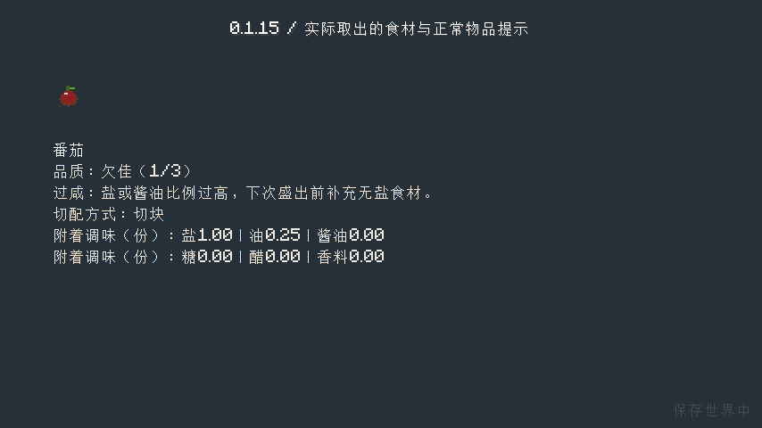
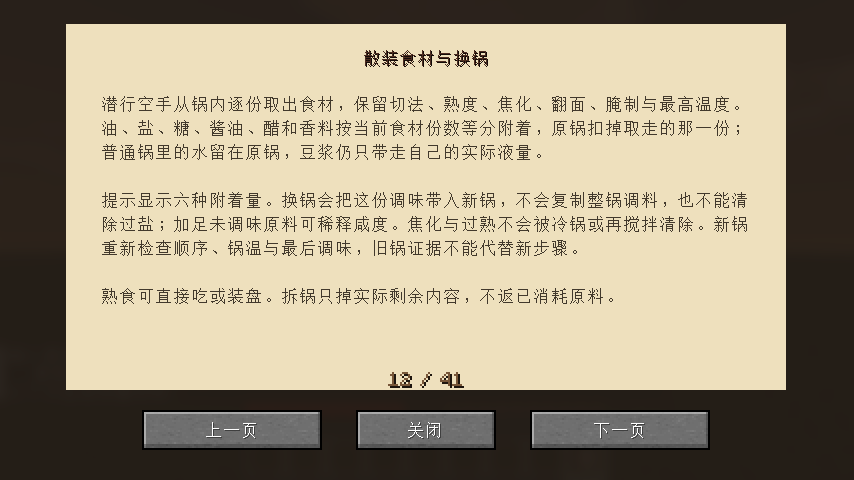

# 0.1.15：散装食材的调味与品质

原版与实际启用Iris的完整制作、分份、换锅、装盘食用和多次保存重开均已通过；最终安装包摘要和源码CI另列于验证记录。

食材从锅内取出时，油、盐、糖、酱油、醋和香料按当前食材份数等分附着，原锅扣除取走份额。拆锅掉落也按同样份额分配；再放入其他锅时只恢复该份调味，避免清洗掉过盐或复制整锅调料。等分是游戏中的简化，不模拟不同食材吸附速度。普通水留在原锅；豆浆仍遵循已有实际液量与一次返罐规则。

熟度、切法、焦化、翻面、腌制和最高温度继续保留。取出的单份按自身熟度与盐浓度显示品质，旁边尚未煮熟的材料不会把它误判为夹生。加未调味原料可以稀释咸度；冷锅或重新搅拌不能抹去焦化和过熟。豆腐已有不可逆的酸味品质与不新鲜状态继续带入。新锅重新记录下料顺序、入口锅温和最后调味，旧锅的邻料与收尾证据不能代替新步骤。

调料支持分数份额，旧整数存档可升级读取。物品提示分两行显示六种附着量；原版熟肉也有品质说明与实际营养惩罚，重复取出根据原版物品基础食物值计算，避免反复扣减。

## 本轮验收

- 83项单元与77项总游戏测试通过，包括反复序列化换锅总量、分份、稀释、不可逆品质、旧存档和异常份额、拆锅掉落及原版熟肉营养。
- SeasoningTransferTest继承实际基础材料合成、真实动物击杀、挖盐矿研磨装盐、小火炼油、切配煮熟。四份食材加共4次盐与1次油，实际取出单份并保存重开，移入第二口锅，再分回两锅各两份并多次重开，最后重聚装两份菜，食用返碗并取出最后一份。不发加工成品，不修改熟度。
- 首次原版流程通过分份与两锅多次重开，在装盘处因测试脚本把原版碗写成错误名称而停止；已修正并重跑，失败日志不算通过。
- TransferGuideTest实际合成食谱并翻到新增换锅说明。物品提示截图使用流程中实际取出的食材。

原版与Iris完整流程及选定实际物品提示/场景画面已核对。教程压缩掉孤立末句，最终另做短流程排版补验；不重跑未受影响的完整制作链。设备、生态、独立美术、建筑、经营、多人及储存/区块保鲜时钟仍按有限待办继续；本版不宣称修复所有保鲜计时起点。

本版不新增或替换模型资源。完整21项客户端清单归位，本轮按依赖选择两组实际流程，不声称21项全部重跑。[机器可读验证](verification/0.1.15.json)记录范围、摘要及发布核对。

发布核对：实际重新下载959382字节JAR，SHA256 `568eb460197e03adf1452799ff90a2ba6fab9f1c991ea43ceff65998d254dc4a`，与本地及服务器摘要一致。[发布页](https://github.com/newFanqie/smoke-kitchen/releases/tag/v0.1.15)；[精确源码CI](https://github.com/newFanqie/smoke-kitchen/actions/runs/39606698504)通过，源码 `a66bb1b65a601a1170d97ec5519a3a778eb66d70`。
