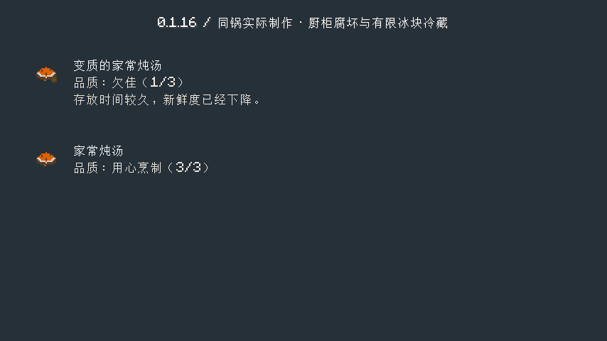
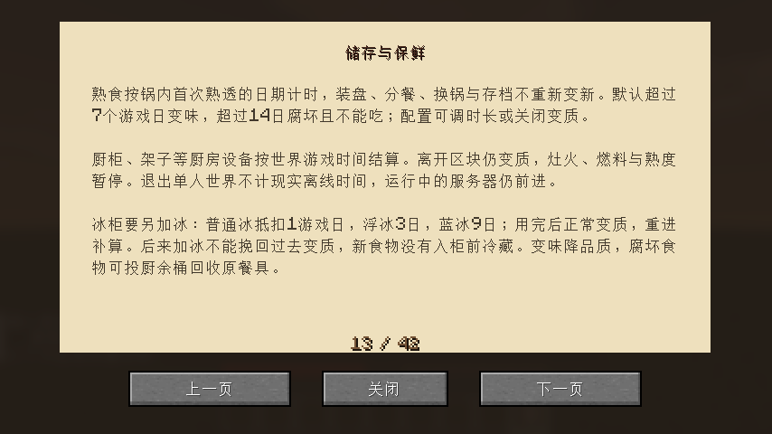

# 0.1.16：储存、离开区块与锅内保鲜

厨房里的厨柜、架子、加工设备与锅内食物统一使用世界的游戏时间结算。离开厨房导致区块卸载，不会冻结保鲜；回来时补算经过的时间。炉火、燃料和熟度继续在卸载时暂停，不会离开后自动煮熟。单人世界退出后不按现实离线时间变质，运行中的服务器仍按游戏刻前进。

食材首次熟透时记录制作日期。装盘、剩菜分餐、散装取出、换锅和搬锅保留该日期，不能在几天后装盘时把旧菜重新变新。变味保留原有过盐、焦化等原因，不会把原本更低的品质提高。腐坏食物不能食用，可装出后投入厨余桶回收餐具；锅内也有变味和腐坏提示。

冰柜先结算有限冰块覆盖的冷藏时间，再判断变质。普通冰、浮冰、蓝冰分别抵扣1、3、9个游戏日，用完后正常变质。玩家与漏斗取放前结算原有内容，后来放入的冰不能倒补已经经过的未冷藏时间，后来加入的食物也不能获得入柜前的冷藏。再次进入世界保留剩余冷量和已消耗冰块。冷藏与回拨时间不能把已经变质的状态还原。

默认仍为超过7个游戏日变味、超过14日腐坏，可配置时长或关闭变质。本轮不更改普通原版食品在原版容器中的规则；已带制作日期的模组食品放入原版箱子后，取回背包时按原日期结算。旧存档里没有制作日期的锅内食物，首次读取时开始记录，不猜测之前未知的日期。原版协调模型资源保持既有版本，本轮增加的是实际保鲜逻辑和说明。

## 验收范围

84项单元与81项总游戏测试通过，覆盖散装制作日期迁移、原版食材成菜的锅内变质、剩菜日期保存、储物取出、有限冰量及序列化、后来加冰/加食物不倒补冷藏、回拨不复鲜和腐坏状态不可食用。

原版与实际启用Iris均从基础材料实际合成工具和设备，击杀鸭与猪、挖盐矿研磨装盐、小火炼油、切配并做熟四份食材。关火留锅半日，保存重开后装成两份菜，分别入实际合成的厨柜和冰柜，额外放入两块冰。再保存重开并真正离开厨房使区块卸载，运行48040个完整游戏刻后返回：厨柜饭菜腐坏且不可吃，冰柜饭菜仍新鲜，两块冰恰好抵扣48000刻且耗尽。实际取回冷藏菜、食用返碗，再重开检查腐坏菜、餐具和空储物设备。

隔离客户端测试暂设1日新鲜/2日腐坏，使用原版200刻速并匹配测试客户端时钟，执行全部游戏刻；未修改制作日期、熟度或加工进度，没有发放工具、加工品或菜肴。测试结束恢复配置；正式包默认7/14日不变。基础材料、临时平台和位置传送属于测试环境，长等待有阶段及百分比。

原版完成实际制作、留锅和两日卸载对比后，返回点落在此前的取水口，玩家坠落，未执行最后取菜；已将正式流程返回点移到实心地面，并用正常重生后的玩家从同一真实存档继续取出、食用返碗及最终读档。续验未替换食物、制作日期或进度。Iris使用修正后的完整流程。最终教程另做两种渲染的单页补验。

中间发现并修正了新世界时间哨兵、实际加冰被外部放置拦截的问题，以及验收脚本的拿回锅盖、后台降帧和远处平台加载问题，相关失败/中止日志独立保留，不将失败运行整体标为通过；原版已完成阶段与同一存档的续验分别记录。本轮只运行上述两组客户端流程，完整23项清单已归位，不声称23项全重跑。

[机器可读验证](verification/0.1.16.json)记录测试范围、摘要与最终发布核对。其余原创素材、设备、农牧、独立建筑、经营及多人验收继续按有限待办推进。
