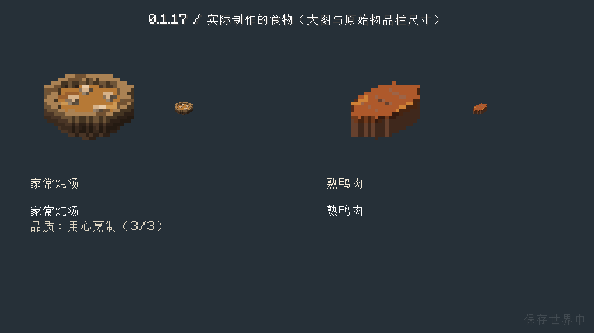
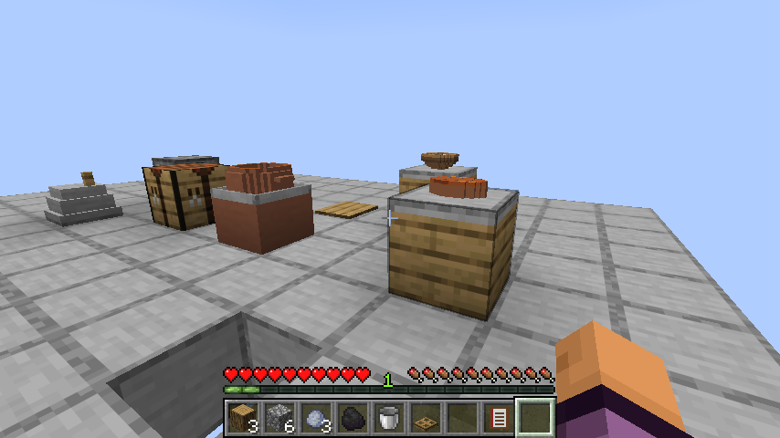
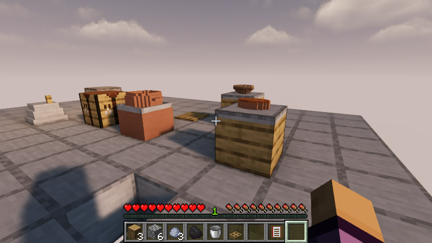
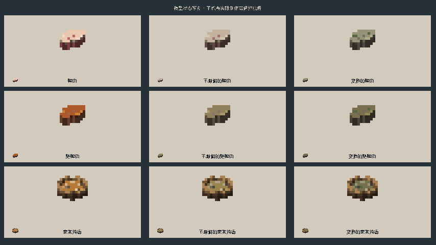

# 0.1.17：炖汤与鸭肉原创外观样例

这一批先完成两种常见成品：家常炖汤与熟鸭肉，并同步调整对应生鸭肉。炖汤是有碗底、阶梯圆碗沿、汤面和四块食材的木碗，与实际使用和食用后返还的原版木碗一致。鸭肉采用带皮肉块轮廓，生肉呈浅皮与粉色肉，熟肉呈烤色与浅刻纹，避免继续沿用相似的平面图标。

三类食物各有新鲜、变味、腐坏三个模型，共九个状态。变味改为黯淡色，腐坏加灰绿表面与少量霉斑；不再只靠通用角标区分。这批使用21张原创16×16像素材质、少量清晰色块和原生JSON体素模型，无抗锯齿、无第三方模组素材，不需要额外资源包才能显示。已有物品ID、合成、食用和保鲜规则不变。

有体积的食物摆上调理台时保持直立，模型底部贴着实际台面，不再沿用平面图标的90度旋转。单份居中，多份最多显示四组，避免层层堆叠。本版实际检查单份炖汤与熟鸭肉的放置、保存重开和取回。

## 验收与截图

原版实际从基础材料制作工具与厨房，击杀鸭和猪、采盐研磨、小火炼油、切配炖煮并装成家常炖汤；另外生成并实际击杀一只鸭，使用掉落的生鸭肉在真正的熔炉中烤熟。实际烧制平滑石、合成两个调理台，把刚制作的汤和鸭肉放上台面。保存重开后取回两种食物，实际食用，炖汤返还木碗；最后把锅中剩余一份盛出，再重开核对剩菜与空台面。未发放工具、加工成品或菜肴，未修改熟度、制作日期或保鲜状态。

本轮运行FoodSamplesPreviewTest与FoodSamplesFlowTest两组客户端检查，后者继承第一餐的真实制作流程。九种状态对照只是在预览界面中构造展示模型，**不是实际等待变质的证据**；真实制作证据使用玩家持有、摆放和食用的产物。没有重跑0.1.16已经通过的两日卸载保鲜等待。完整客户端清单25项，本版不声称25项全部重跑。

原版与实际启用Iris 1.11.4、Sodium 0.9.2、MakeUp Ultra Fast 9.6的同一实际流程通过，截图已目视核对。84项单元、81项总游戏测试与资源/接触审计通过；完整25项清单恢复，隔离Iris归位。最终发布核对见[机器可读验证](verification/0.1.17.json)。这只是有限的代表样例，其他原料、菜肴、动物外观与设备、生态、独立建筑、经营和多人仍按既定清单推进。

发布核对：实际重新下载972472字节JAR，SHA256 `4a549ad433c8b5dc52449c63a58b624f27efa3327646ad414ac4ef402e3c241e`，与本地及服务器摘要一致。[发布页](https://github.com/newFanqie/smoke-kitchen/releases/tag/v0.1.17)；[精确源码CI](https://github.com/newFanqie/smoke-kitchen/actions/runs/39638728658)成功，源码 `c75447055c36fb522dca2876a9739a9f1a9c4938`。Git域名连接失败时改用官方Git数据接口，按已提交文件字节、树及提交SHA精确核对后上传，未重写源码。
