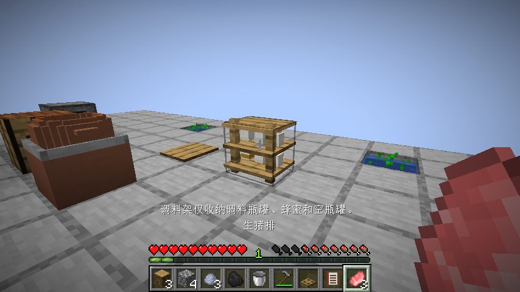
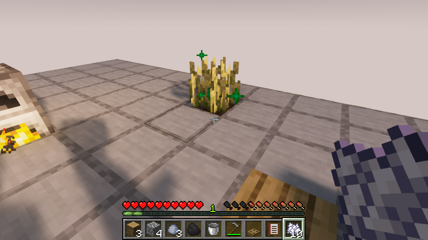

# 0.1.18：浅水稻田与按格调料架

稻田土继承原版FarmlandBlock，并使用SimpleWaterloggedBlock的灌排水行为。先锄泥土成为耕地，再持水桶点顶部，形成含一份水源的浅水稻田；空桶能抽回这份水，重新灌水可恢复。土面与碰撞高度同为13/16，让原版流体显示在土面上方，不另外画一张假水面。沿用原版踩踏、上方实心方块与干燥规则；挖掉返泥土。一块田只保留一份水，孤立干田重复抽取不会再出水；接入外部水源仍遵守原版流体规则。

稻谷可以种在稻田土上，沿用原版光照、自然生长和骨粉。在孤立且已经排水的田里暂停生长，骨粉不会被无效消耗；补水恢复。旧版靠近水源的普通耕地仍可种稻谷，已有农田不会被强制转换。稻谷成熟仍掉原料和种子，可采收、留种重种。

调料架改成两层各三格，每格放一个瓶罐。准星对准格位，持物右键存入，空手右键拿回同一格，四个朝向采用相同坐标规则。仅收调料、蜂蜜、空调料罐和玻璃瓶；不接收普通食物和其他杂物，已有格子不会被覆盖。新放入的瓶罐按实际内容显示，移除旧模型中固定的假瓶子。瓶罐直立接触搁板，盐、油、酱、醋、香料及蜂蜜按内容显示颜色，满瓶、使用中和空瓶可区分；使用中的外观代表半瓶，精确余量继续留在物品数据里。

取放和保存不会用掉、装满或复制调料。漏斗遵守六格与每格一件的容器限制。旧存档的前六格保留，六格以外的历史物品也不删除，可潜行空手逐次取回，或拆架回收。配方按设计调整为三木板、三木棍、一玻璃，接入原版配方发现；旧架子不需要重做。食谱书新增灌排、干田与格位操作说明。

## 实际验收记录

客户端从基础材料合成工具、厨房和食谱书，实际击杀、采盐研磨、炼油、切配炖汤并食用返碗；继续烧制额外玻璃，制作石锄和调料架。使用实际做出的剩余三次盐罐与三次猪油、四个实际合成的空罐检查六格陈列；普通生肉被拒绝，库存不减少。实际挖平台地面、放泥土、锄地、水桶灌排、种植、骨粉干田负例、重灌催熟、采收留种与重种，保存重开后按格取回盐罐再放回，第二次重开精确量仍一致。

测试场地可提供基础材料、种子、水源和平台，不发工具、加工品或菜肴，不直接设定作物成熟度、制作日期或调料用量。前两轮分别因测试未给熄灭的熔炉补煤、未继续制作足够木棍而中断；一次旧存档续验因测试角色身份不同而背包断言失败，未向其注入加工品。相关失败日志独立保留，临时续验类已移出源码。Iris最终从基础材料完整通过；原版依实际阶段和原角色同存档续验接续核对，不将失败运行计为通过。场地另补实心基础与边缘，避免挖地或截图传送跌入虚空。

原版实际阶段与同存档续验接续通过，实际启用Iris 1.11.4、Sodium 0.9.2、MakeUp Ultra Fast 9.6的完整流程通过，最终模型与指南截图已目视。84项单元、86项总游戏测试通过；四向格位和旧版溢出回收由游戏测试核对，客户端实际操作南向架子。本轮运行生产/种植流程与实际指南两组，完整27项清单已归位，隔离Iris已禁用。最终发布摘要见[验证记录](verification/0.1.18.json)。本版未完成香料种植架、其余独立建筑、经营或多人内容，继续按有限待办推进。

原版证据分阶段记录：真实存档111先完成原料制作、食用与架子合成，测试误认放置朝向导致中断。随后以正常离线启动参数使用原角色，加载原存档已有背包和设备，没有编辑或复制背包物品、制作日期或作物成熟度。实际灌排、干田负例与成熟已完成，最后的采收驱动被旧的地下石料寻路打断；从同一存档接续实际收取原掉落、重种、瓶罐取回再放入、两次重开与指南。未把任何失败运行整体写成通过。实机同时修正了瓶罐物品模型索引/原版石英材质路径，以及稻苗挡水时直接点苗灌排的入口；漏斗实际单件转移的格位限制也已回归。

发布核对：实际重新下载993999字节JAR，SHA256 `56772e82bd3bba2745fe458c32b820f6d42bc62b5eff3585a26f96f3df5d374c`，与本地及服务器摘要一致。[发布页](https://github.com/newFanqie/smoke-kitchen/releases/tag/v0.1.18)；[精确源码CI](https://github.com/newFanqie/smoke-kitchen/actions/runs/39655906922)成功，源码 `d60ea8fec5dda46ff0dd984c38c0feaccfd91765`。

旧版架子前六格若存的是非瓶罐，现有陈列会按空罐轮廓显示，仍可原样取回；其原物显示列入下一轮兼容补验。正常新增瓶罐收纳和精确余量不受影响。
