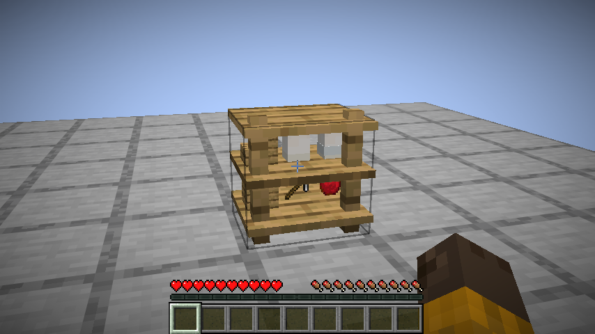
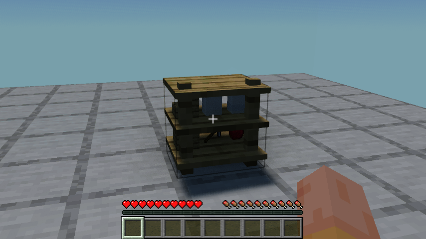

# 0.1.19：旧调料架原物显示与无损取回

旧版调料架可能保存苹果、工具或建筑方块。0.1.18保留了它们的数据，但陈列时把非瓶罐画成空罐。本版使用原物品模型及其自身组件，按模型实际边界缩放到层板之间，底部接触层板；新放入仍只允许调料瓶罐。盐罐、油罐原有满/使用中显示不变。

## 实际验证

本轮是**旧存档兼容夹具**，不是基础原料生产或自然变质证据。直接建立四个朝向的旧架，每架放苹果17个、自定义名称且已损23耐久的铁镐、木板3个、损7用量的盐罐、玻璃瓶和楼梯2个。原版及实际启用Iris/MakeUp Ultra Fast的客户端均检查六格原模型、层板接触和边界；真正关闭并重开世界，以生存玩家逐格右键取回24格内容，核对原数量、名称、耐久与组件；第二次重开确认没有复原或复制。

本轮仅运行新增的LegacyRackTest，未重跑其余27项长客户端流程。完整28项清单已恢复，隔离Iris已禁用。84项单元测试、86项总游戏测试与资源校验通过。首次编译发现测试保存接口名称错误，修正后再运行；最初镜头遮挡较多，最终正午斜侧视角重新运行并截图，不将初次编译失败算作通过。

## 安装与范围

Minecraft 26.1.2，Fabric Loader0.19.2，Fabric API0.149.1+26.1.2。移出旧JAR，安装smoke-kitchen-0.1.19.jar并保留对应Fabric API。安装包994543字节，SHA256 `9b7767e734d5d12c3a9d5c6b5a4a5021821ab58e50618614a6230b0fcb07a055`。源码CI与重新下载的结果在发布后补录。

香料种植架当前仍是带固定叶片的普通收纳，**不算完成**。它与调料架不同；下一轮核对原版作物共同逻辑，补真实植株、土壤/支撑条件、生长、采收、拆除回收与存档。为使本次已完成的兼容修复独立可安装，种植架功能顺延至0.1.20。其余有限设计继续，0.1.17代表食物美术仍等待反馈。
