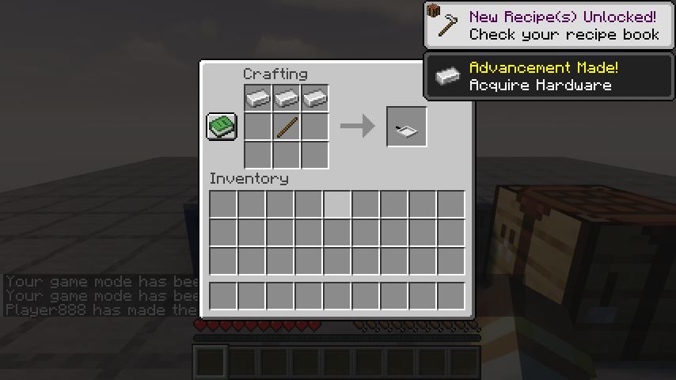
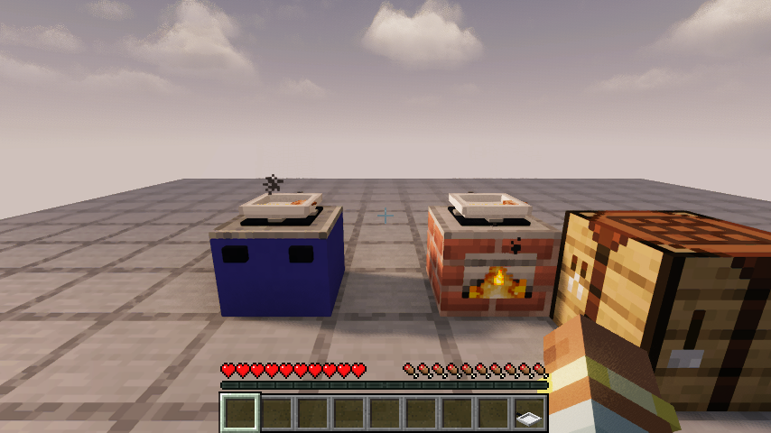
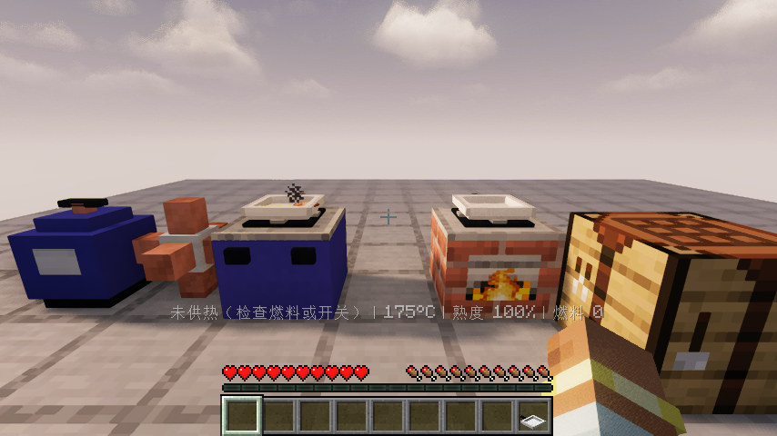

# 0.1.2：低灶面、真正熟食与可用燃气

Minecraft Java 26.1.2 / Fabric Loader 0.19.2 / Fabric API 0.149.1+26.1.2。移出所有旧版模组 JAR，只保留一个 `smoke-kitchen-0.1.2.jar` 和对应 Fabric API。Iris、Sodium、光影包均为可选，不捆绑在模组内。

## 本版改动

- 灶台炉身降到14/16方块高并封闭，锅具右键嵌入灶面；旧的上下叠锅自动迁移，保留食物。锅和食材的实际显示高度一起调整。
- 煤炉和气罐能把原版生鸡肉煎为真正的熟鸡肉，取出即可食用。优先查询原版篝火/烟熏炉/熔炉配方，不再仅给生肉附加隐藏熟度数据。
- 一块煤的有限燃烧量足以完成整份生肉。锅具独立计算食材熟度；新加生肉不会继承熟度。煮、蒸、炖没有水不会煮熟。
- 直接接罐与管网供气均可用；管网搜索只计连接节点，18根管路通过回归。气源有限，断管后只使用灶内余气。
- 气罐有100%、使用中50%代表图标、0%三个独立物品，实际储气量精确保存。工具有使用中与损坏状态，调料/水壶有使用中状态，新增食品有不新鲜/变质状态；没有创建99个余量物品。
- 20条工具修复配方使用原版材料；变质饭菜可堆肥并返还碗。盛完一锅保留灶旁气罐，分餐后破坏不再重复掉生料。
- 所有304个模组物品及状态集中在“烟火厨房”分类；首次打开创造物品栏自动选择它。
- 刀、铲、勺、夹子等改为继承清楚的原版模型。炉口使用原版熔炉燃烧面和篝火火焰动画，配合原版烟雾、火焰和声音；燃气火焰限制在锅底，不向食物飘火星。
- 带盖锅具搬运保留水、每份熟度、做法与盖子；气罐精确余量保存。原版点燃的篝火与熔炉类设备也可给上方锅具供热。

## 操作

1. 放好灶台，持锅右键灶台，锅嵌入台面。
2. 煤点灶台侧面装燃料；有气的气罐可直接点天然气灶侧面安装。
3. 食材点顶部投入。空手点侧面调火，锅具顶部空手切换支持的做法。煮、蒸、炖用水桶或水壶加水。
4. 持刀切配、持铲翻动；观察温度和熟度，熟后减火或关火，利用余热。
5. 潜行空手点顶部取单份食材，或持碗盘盛菜。取出食物后若它占据主手，需要换到空手才能拆气罐。
6. 潜行空手点气灶侧面拆罐；潜行持隔热布点顶部取整锅。

储气罐用有气的罐补气，空罐取气。满罐600单位；部分罐图标代表50%，提示显示真实余量。开采机贴含气岩层，管道连接储气罐和气灶。

## 验收记录

本版在实际图形客户端用正常交互数据包运行操作，不用直接设置熟度代替烹饪：

| 场景 | 结果 |
| --- | --- |
| 打开创造物品栏 | 自动选中厨房分类，断言分类覆盖全部304个条目 |
| 放置设备与原版工作台合成 | 实际放置煤炉、气灶；工作台放3铁锭和1木棍，取出平底锅 |
| 煤炉完整流程 | 嵌锅、加煤、投生鸡肉、正常等待1100游戏刻，显示熟鸡肉，潜行取回真正熟鸡肉 |
| 气罐完整流程 | 连接气罐、嵌锅、投生鸡肉、同样等待并变熟，拆回使用中气罐 |
| 管网完整流程 | 连接管道与储气罐，持满罐补气，打开气灶；检查气源减少、灶内得到实际气量 |
| 搬运与保存 | 游戏回归检查带盖搬锅并重新安装，保留水、熟度和做法；序列化/恢复保留气罐精确余量；完整整世界退出重进另列后续验收 |
| 状态及回收 | 使用中/损坏工具、部分气罐精确余量、食品不新鲜/变质、堆肥返碗、分餐不复制原料且保留气罐 |
| 烹饪约束 | 后加生肉独立熟度，无水煮蒸不熟、过火焦化、搅拌影响焦化、余热与分餐锁定 |

资源检查通过；11项烹饪单元测试、20项自定义服务端游戏测试及1项原版空测试通过。原版渲染与 Iris 1.11.4 + Sodium 0.9.2 + MakeUp Ultra Fast 9.6 分别运行客户端流程并目视核对截图。Iris测试会断言光影包确实启用。

光影测试包的 `fixedTaaCorrection` 公式产生一条非致命解析警告，当前测试画面和流程仍正常，未发生光影回退；未修改或分发该光影包。这是上述具体组合的验证，不代表所有光影包专有的PBR/发光规则均已适配。未发现本模组模型或纹理缺失警告。

## 尚未完成

本版主要处理用户反馈的基础厨房问题。严格菜谱切法与投料阶段、其他原料/菜肴图标、独立生物外观、地区生态、九类建筑独立蓝图、村民职业、订单、宴席和食谱收藏继续按已确认设计实施。完整无作弊生存闭环、双客户端并发、整世界存档迁移与长期性能仍需后续专门验收，不以本次测试替代。
