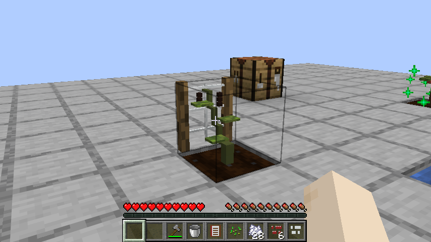
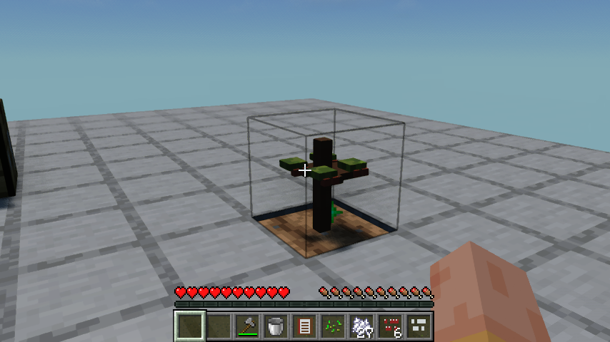
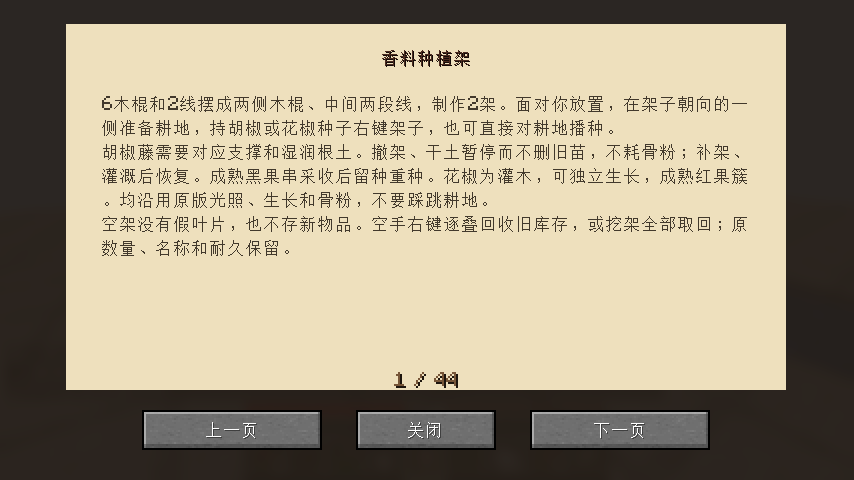

# 0.1.20：真实香料种植架

用6根木棍、2根线在工作台制作2架。架子面对放置者，在朝向的一侧准备真实耕地和空位，持胡椒或花椒种子右键播种。沿用原版种子BlockItem放置、权限/距离、耗种与进度入口，也可直接对耕地播种。新种子不存入架子库存。

胡椒藤需要朝向自身的支撑架和湿润耕地；没有支撑、土干时暂停生长和骨粉入口，不吞骨粉，也不删除旧苗。加水、补架恢复。花椒按灌木处理，可以独立生长。两者沿用CropBlock光照、随机生长、骨粉、成熟掉落和留种规则；胡椒另用继承的PepperCropBlock保留实际支撑方向。现有无支撑胡椒地需要补架和灌溉。

空架改为贴近植株一侧的木桩绳网，模型和薄碰撞按朝向一致，不再自带固定假叶片或浮空旧物。植株扎入原版耕地顶面，胡椒逐阶段向支撑方向攀伸，成熟挂黑果串；花椒长成矮灌木并结红果簇。几何原创，材质引用清晰的原版木纹、绳网和植株配色，没有复制参考模组素材。并非所有美术已经完成。

旧版架子的27格数据保留：空手逐叠回收，或挖架掉落其余原内容。禁止新通用投料和漏斗塞入，漏斗仍可取出旧内容。教程和种子/设备提示已更新，关键规则在食谱首页一页显示。

## 真实客户端流程

原版与实际启用Iris1.11.4/Sodium0.9.2/MakeUp Ultra Fast9.6均从木材、线、圆石、铁等基础材料实际合成工作台、木锄、石斧、水桶、食谱及4个种植架；实际放置、锄地、播种，验证未耕地、不适配种子和占用位置不耗种；验证干根不耗骨粉，真实水桶灌溉后恢复；实际挖掉花椒身旁的架子后继续用骨粉使灌木独立成熟；采收胡椒果时断言新增至少2粒种子，再实际重种、挖除支撑暂停，再在读档后补架恢复，最终两次关闭重开。

耕地吸水等待使用实际200刻/秒加速，结束恢复20刻/秒；没有设置湿度、成熟度、制作日期，也没有给加工成品冒充产出。旧架兼容部分另设明确夹具：0格64圆石、5格17苹果、26格自定义名称且损23耐久的铁镐；保存后真实空手取回旧镐，再实际挖架收回余物。此夹具不是原料生产证明。

最初注水测试视线碰到孔旁地面，修正观察位置；随后实测发现空手也会先进入useItemOn，被种植入口拦截，修正后增加真实方块入口回归。最终原版与Iris均是从头完成的成功流程，不把前两次中断整体算通过。新版指南已目视检查，完整29项客户端清单恢复、隔离Iris禁用；本轮仅运行TrellisFlowTest，不声称29项全重跑。84项单元、88项总游戏测试与资源/锅具/食品美术审计通过。

## 安装与后续

Minecraft26.1.2 / Fabric Loader0.19.2 / Fabric API0.149.1+26.1.2。移出旧模组JAR，安装smoke-kitchen-0.1.20.jar并保留Fabric API。JAR1008574字节，SHA256 `026837d8f1c0407199148bf484b27677de6ba60dc763f291f1c9dbe11cff226e`。精确源码`803fbe7a3cd71c261adc95172235bfbc52ac50dc`的[CI](https://github.com/newFanqie/smoke-kitchen/actions/runs/39680601669)已通过；[发布开发版](https://github.com/newFanqie/smoke-kitchen/releases/tag/v0.1.20)后实际重新下载，SHA256与本地/服务端摘要一致。验证见verification/0.1.20.json。

下一轮0.1.21聚焦晾晒架：先读现有加工/晾晒实现，核对真实内容显示、露天雨水影响、原料取出以及区块卸载后的时钟，再完成有限可验收范围。清洗、烟道、家具、农牧、九种独立建筑、经营、多人及性能等继续按有限清单推进。0.1.17食品代表样例仍待反馈，不据此停掉独立功能，也不盲目扩展一大批食品美术。
