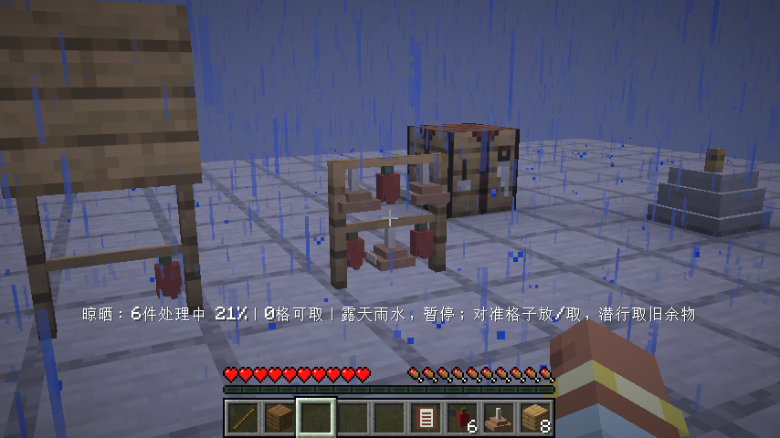
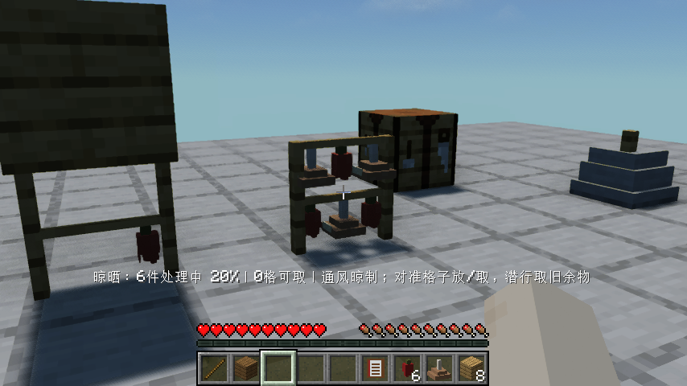
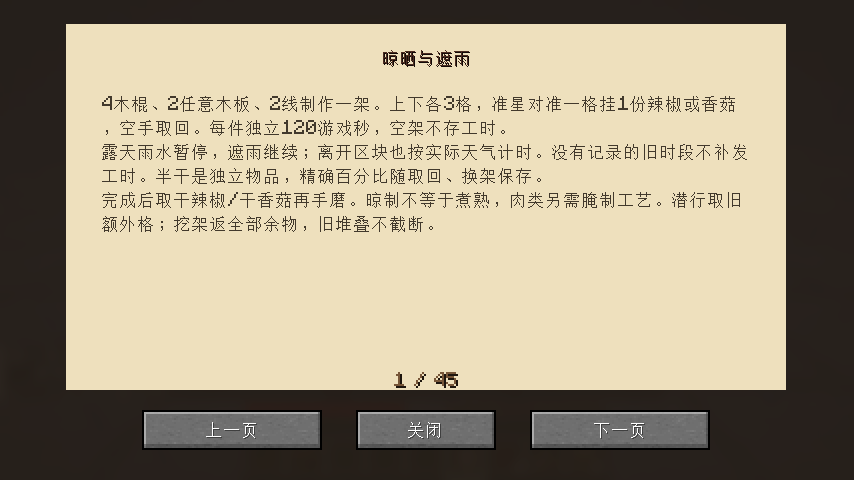

# 0.1.21：六格真实晾晒与天气时钟

4根木棍、2根线、2块任意木板在工作台制作一架，支持混用木板。上下各三格，对准具体格挂一份辣椒或香菇，空手取回。每件独立晾制120游戏秒，新食材不会借用空架等待或邻格工时。露天下雨暂停，真实木板遮雨后继续；雪地和无雨地区按原版降水类型判断。

半干辣椒和半干香菇是两个独立注册物品，创造栏以50%代表中间态；真实取出保留精确进度，换格、换架、漏斗转移、拆架与读档均不清零。挂架和物品使用原创立体辣椒/菌盖轮廓，鲜、半干、干逐步收缩变深；绳段贴住两层横杆，空架没有固定假食物，薄碰撞跟随朝向。材质引用清晰的原版资源，没有复制参考模组素材。

世界保存原版实际晴雨变化。厨房真正卸载时，露天只累计有记录的非雨天游戏刻，遮雨架累计经过游戏刻；实际关闭重开保存天气历史和各件进度。未知旧历史不补发晴天工时，历史最多保留4096次变化；未加载期间不模拟未知的屋顶改动，沿用卸载前观察到的遮挡条件。关闭游戏不按现实时间惩罚。

每格限一件，漏斗批量输入整体拒绝而不截断。旧架27格原物仍可潜行空手取额外格，或挖架掉落；旧叠堆和自定义组件保留，旧共享工时最多迁给一件合适原料，不复制给六格。

## 实际操作与画面验收

原版与实际启用Iris1.11.4、Sodium0.9.2及MakeUp Ultra Fast9.6，均用基础材料实际合成工作台、石斧、手磨、食谱和三架（混用橡木/云杉木板），真实放架、搭木板遮雨、挂六件原料；等待空架后放新料仍从零开始，旧半干料实际取下换架，邻格新料不能借进度。

真实雨天核对露天暂停、遮雨继续，实际保存关闭重开。玩家传到实心远处平台，逐阶段断言厨房区块确已卸载，经过雨→晴→雨后返回，露天增加的工时与独立监听器统计的实际非雨天刻数一致（允许3刻边界误差），遮雨新料已干；再次重开继续完成，实际取干辣椒/干香菇并在手磨加工成辣椒粉/菌菇粉，最终第三次重开保留产物。

晴雨命令有原版渐变，600刻“clear命令之后”不等于600刻真正无雨。早期测试用错预期，改为独立逐刻观测，并加上真实读档后的历史区间等值检查；没有修改熟度、制作日期、晾晒进度或历史冒充生产。测试以200刻/秒加速真实游戏时钟，结束恢复20。旧架兼容另设明确夹具：0格64辣椒、26格名为“旧晾架的镐”且损23耐久的铁镐；实际空手取镐、挖架收回全部64原料，不作为基础原料生产证据。

镜头转动后等待提示刷新，避免截到前一目标的进度。原版/Iris关键挂料、雨天、干制、指南与读档画面已目视核对。完整30项客户端清单恢复，隔离Iris禁用；本轮只运行DryingFlowTest，非全部30项重跑。84项单元、90项总游戏测试、325条物品/资源校验、28组锅灶与7盖接触及食品美术审计通过。本版调料干料不以“食用”验收，实际手磨产物是该流程终点。

## 安装与剩余范围

Minecraft26.1.2 / Fabric Loader0.19.2 / Fabric API0.149.1+26.1.2。移出旧版，安装smoke-kitchen-0.1.21.jar并保留Fabric API。JAR1026629字节，SHA256 `bbaabb682f53390a02dae6055af49b8613ff6c9d318bccde692ffe195fc34fb8`。精确源码CI与发布后实际重新下载结果待补录。

本轮完成两条既有植物干制链，不把肉晾干等同做熟。下一轮0.1.22先核对设计中的盐腌风干肉及胡椒/孜然干制和调料容器，补有限真实保存/加工路线；不能把晾晒架整个设计标为完成。其余清洗、排烟、家具、农牧、九种独立建筑、交易订单宴席、多人及性能待办保留。0.1.17食品代表样例仍待反馈，不盲目扩展大批同风格成菜。
