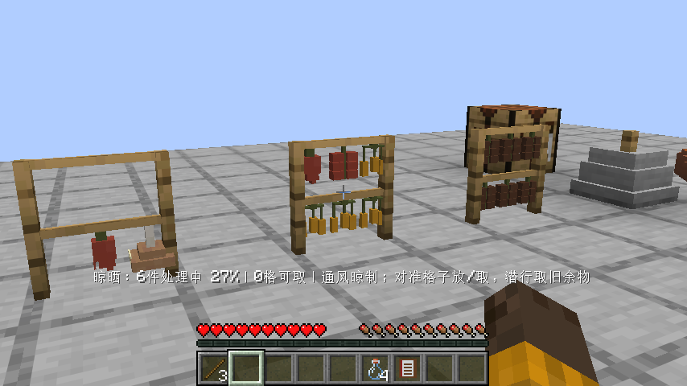
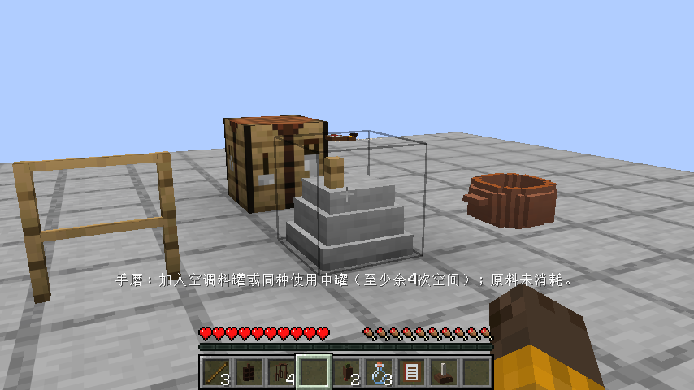
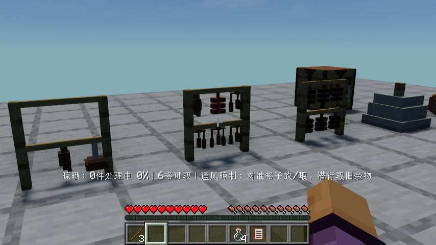
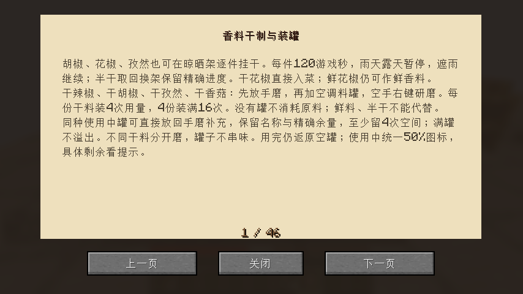

# 0.1.22：香料干制与真实研磨装罐

胡椒、花椒、孜然加入六格晾晒架，每件独立120游戏秒。各新增一个半干和一个干制物品，半干以50%代表中间图标，真实进度仍精确保留。沿用实际天气、遮雨、换架和存档时钟。干花椒可作为花椒入菜，鲜花椒仍能鲜用，不删除旧原料。

三种作物有独立原创原生体素轮廓：胡椒串果由绿转褐黑，花椒果簇干后显示壳与深色籽，孜然用连接的枝梗和细长籽荚。鲜/半干/干分别变化配色和尺寸，与架杆的绳段接触；材质引用原版清晰色块。没有复制参考模组资源，也没有借新条目顺序改掉原有菜肴的生成配色。其他成菜样例仍等反馈，不盲目大批扩展。

## 干料和容器都必须真实存在

四种粉的旧短配方已修正。干辣椒、干胡椒、干孜然、干香菇放手磨，另放空调料罐，空手右键研磨：每份干料增加4次用量，4份才装满16次。原来的鲜胡椒、鲜孜然不能跳过晾干；半干料也不能冒充干料。没有罐，材料原样保留。

使用中罐可放回手磨，加入同种干料补充，沿用原罐、名称/组件和精确余量。只消耗装得下的完整干料：例如余量8次只消耗两份补满；余量13次时空间不足4次，保持原料和罐不动，先再用1次才可补。满罐不吞料，不同干料混入时拒绝；输出库存满时整笔回滚，堆叠空罐不会少算或复制。现有旧满罐仍保留实际16次，不追溯删除。使用中代表图标仍为50%，提示显示精确次数，用尽返空罐。

## 实际操作验收

原版及实际启用Iris1.11.4/Sodium0.9.2/MakeUp Ultra Fast9.6，均只提供木材、线、圆石、玻璃、黏土、书和原作物等基础材料。玩家实际合成工作台、手磨、陶锅、食谱、三架及四个空罐，实际挂六份胡椒、四份孜然、一份花椒、两份辣椒与一份香菇。

实际验证鲜胡椒不直接磨粉；取半干香菇与真实空罐放磨，仍不加工，再实际取回挂架。保存关闭重开后晾干，取回三种新干料并将干花椒真实投入陶锅；缺罐研磨不消耗干胡椒。一份干胡椒加一个实际合成罐只得4次，再用三份干胡椒补同罐至16次；真实向陶锅调味3次剩13次，拒绝溢出且返原物，真实再用1次后补满。不同干料与空罐同时放磨的负例不吞材料；四种粉均实际研磨装入各自一个罐。

再次保存重开保留满罐16次及三罐各4次，向实际合成的未加热陶锅分别使用那三罐共12次，真实返还3空罐；最终第三次重开核对满胡椒罐、3空罐、锅内先后累计16次香料和空手磨。此为实际调料耗量/返罐入口，不宣称本版做熟或吃了一道菜。自定义名称罐、库存满回滚另列服务端契约夹具，不混作自然制作证据。没有直接给成品或修改工时/日期/成熟度；仅将真实晾晒游戏时钟加速200刻/秒，结束恢复20。

早期测试断言把27格中的空旧库存算为挂料格，中断后改为真实前六格；生成脚本本机Node14不支持Array.at，已修正并重新生成，未把旧资源校验当成新资源通过。随后连接最终孜然枝梗，最终原版/Iris完整流程均重跑。失败运行不整体称通过。

84项单元、93项总游戏测试及331条资源、锅灶接触与食品美术审计通过。完整31项客户端清单恢复、隔离Iris禁用；本轮仅运行SpiceChainFlowTest。历史DryingFlowTest已更新为真实制罐与4次用量断言，但没有无故重跑旧版整个卸载晴雨长链。最终指南一页可读，关键原版/光影画面已目视。

## 安装与后续

Minecraft26.1.2 / Fabric Loader0.19.2 / Fabric API0.149.1+26.1.2。移出旧JAR，安装smoke-kitchen-0.1.22.jar并保留Fabric API。JAR1045592字节，SHA256 `e2c9e5671dec07ae5b5310003b4fa98c5e6f18fb669664e44bd3c1275483bd61`。精确源码CI与发布后实际重新下载结果待补录。

下一轮0.1.23独立处理设计中的肉类盐腌风干：真实动物击杀取肉、切配/用盐、逐份腌制、干制与保存边界，不能晒成原版熟肉。先核对既有保鲜/切配数据，再实现有限可验收流程。清洗、排烟、家具、农牧/动物美术、九种独立建筑、职业交易/品质订单/宴席收藏、多人并发、迁移及性能待办保留。整体设计尚未完成，自动续做保持启用。
