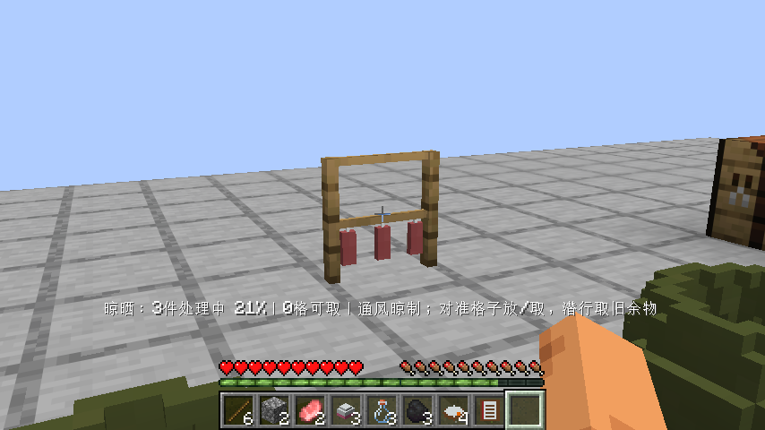
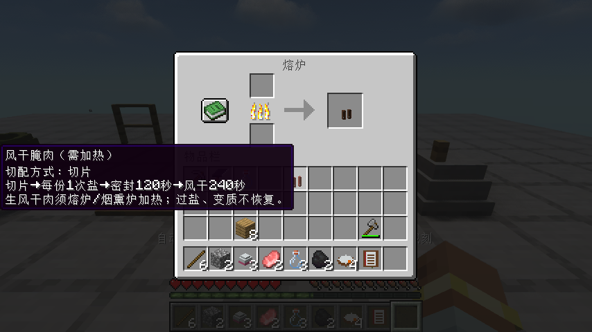
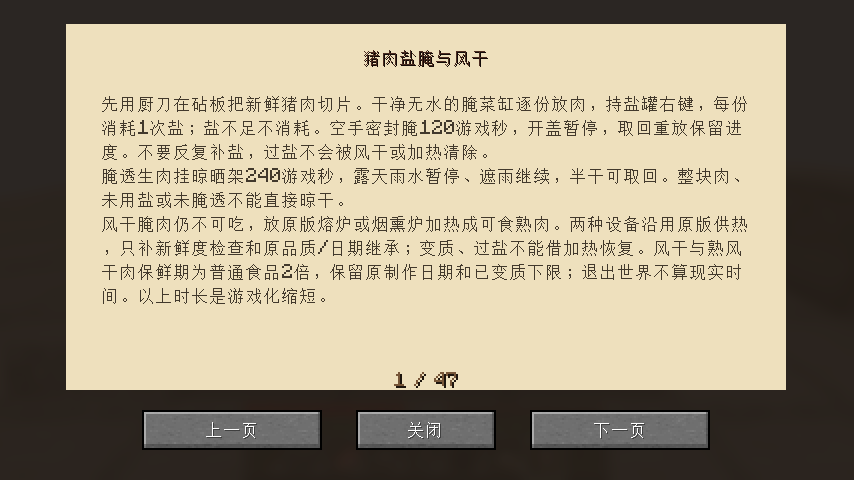

# 0.1.23：猪肉盐腌、风干与原版加热

本轮完成一条可实际吃到成品的猪肉保存路线，复用砧板、腌菜缸、晾晒架、原版熔炉与烟熏炉。其他肉不会自动变成猪肉，整体设计仍未全部完成。

新鲜生猪肉在砧板切片，逐份放进干净无水的腌菜缸。持盐罐右键，每份消耗1次盐；盐不足不吞料，整块肉、已入锅的半成品或混有其他原料不能冒充干腌。反复补盐会保留过盐标记，不会被后续风干或加热清除。空手密封腌120游戏秒，开盖暂停；潜行空手开盖取回，重放只重记观察时间，不赠送携带期间工时。

腌透生猪肉挂晾晒架240游戏秒，沿用实际天气时钟、雨停/遮雨继续和取回进度。植物仍为120秒。盐腌中、腌透、半干、风干和熟风干肉及各变味/腐坏共15个独立物品，原创原生体素肉条、脂肪纹和盐粒，配清晰的原版材质；没有复制第三方资产。密封仍不在盖外显示肉。

风干腌肉仍不可生吃，实际放入熔炉或烟熏炉加热，得到熟风干腌肉。代码继承原版SmeltingRecipe/SmokingRecipe及原版配方编解码、燃料与进度，只补新鲜度/过盐检查和原名称、品质、制作日期继承。未切、未用盐或未腌透不能直接晾成即食肉；变质或过盐也不能借熔炉洗成正常成品。失败腌肉可放厨余桶。

风干和熟风干肉按普通食品2倍的新鲜/腐坏阈值计算，保留原制作日期；已经变味/腐坏的下限写回物品，变成较长保鲜状态也不能重新变新。原版普通食品的规则不替换，退出存档不按现实时间惩罚。腌菜缸合成按设计修为5陶瓦和1木盖，不再使用旧两陶瓦短配方。时长为游戏化缩短，不是现实食品加工指导。

## 实际流程与验证边界

原版和实际启用Iris1.11.4/Sodium0.9.2/MakeUp Ultra Fast9.6均实际从基础建筑材料合成工具、工作台、熔炉、砧板、手磨、两个腌缸、晾晒架、食谱和空罐；实际用斧击杀3猪获得肉与脂，实际采盐矿并手磨盐晶、装4次用量盐罐，切片3份肉、按份用盐。两份正常肉消耗2次盐，另一份实际补两次盐作过盐负例，耗完真实返罐。

实际密封腌制、开盖取一份携带等待，取回重放不补进度；首次关闭重开后实际腌透，三份肉挂干，半干实际取回换格，再次关闭重开后完成风干。过盐肉实际放熔炉，加煤后仍无成品，原肉保留；另两份正常肉实际烧熟，输出日期逐份核对仍来自原腌制材料。将食用测试环境饥饿值设为8、视线朝向天空，真实按住使用吃掉1份并验证饥饿值增加，第三次实际关闭重开保留另1份熟肉。没有给肉、盐或加工成品，没有修改工时、熟度或日期。

等待使用真实200刻/秒，结束恢复20。保鲜2倍/不可逆变质、古老但尚未换图标的肉、命名组件和模拟先前观察时间等为另列服务端契约夹具；没有声称新跑了自然8天或28天等待，也未无故重跑旧长酿造/卸载晴雨流程。最初夹具误用了禁止的腌缸漏斗取物接口，返回空物；已改明确契约移出，真实玩家取回另行实际验收。首轮原版到出炉后因视线仍对熔炉、饥饿环境不明确而在食用处中断，修正后最终原版/Iris重跑，不把中断运行整体说成通过。

84单元/97总游戏测试、346条资源、锅灶接触和食品美术审计通过。完整32项客户端清单恢复、隔离Iris禁用，本轮仅运行CuredPorkFlowTest；最终指南单页和实际肉条/加盖/熔炉输出画面目视核对。

最终截图发现新增长提示越过屏幕，拆为短行后再跑最终原版3m32s和Iris3m34s，重新打包；最终提示完整可读。

## 安装与后续

Minecraft26.1.2 / Fabric Loader0.19.2 / Fabric API0.149.1+26.1.2。移出旧JAR，安装smoke-kitchen-0.1.23.jar并保留Fabric API。JAR1081817字节，SHA256 `4cf92ff3932a111633f65b7c60abf7b67c51900012d95729658d49b4a81da72e`。精确源码CI与发布后实际重新下载结果待补录。

下一轮按既定设备待办核对洗涤槽的实际储水、洗菜和重复容器清洗边界，先读设计和已有实现，不把普通储物和静态水面算完成。手磨展示支撑接触、空罐组件一致性、排烟家具、农牧、九种独立建筑、经营/多人/迁移及性能仍保留。成菜美术样例待反馈，独立功能继续。
