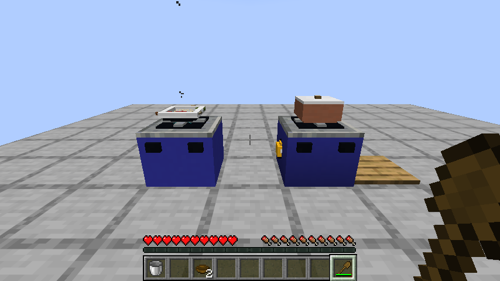
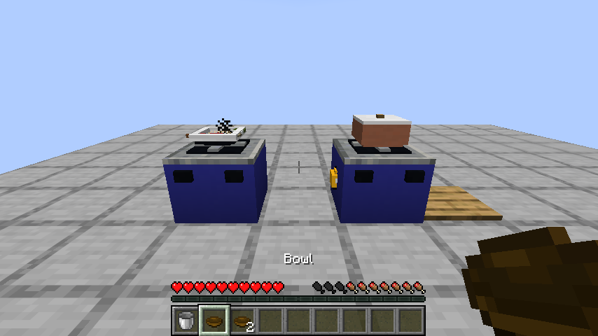
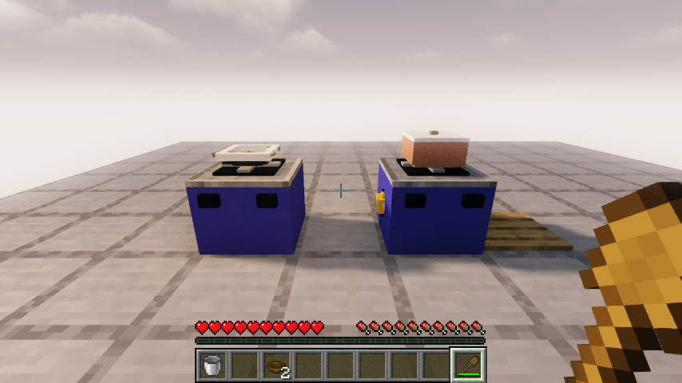

# 0.1.3：切法、投料顺序和一顿真正做出来的炒饭

环境仍是 Minecraft Java 26.1.2、Fabric Loader 0.19.2、Fabric API 0.149.1+26.1.2。更新时移走旧模组JAR，保留对应Fabric API。

## 四道菜的关键规则

| 菜谱 | 实际判定 |
| --- | --- |
| 蛋炒饭 | 先加油，锅至少110°C再下蛋；蛋至少四成熟后加两份已经煮好的米饭，最后放切碎的葱；最后投料后翻炒至少3次 |
| 番茄炒蛋 | 油锅至少110°C下蛋，蛋至少四成熟后再放番茄；最后投料后翻炒至少3次 |
| 酸辣土豆丝 | 土豆必须切丝、蒜必须剁碎；先下蒜，油锅至少100°C下土豆丝；原料齐全且至少七成熟时淋醋，最后投料后翻炒至少3次 |
| 麻婆豆腐 | 猪肉必须剁碎、豆腐切块；油锅至少100°C下肉末，肉末至少六成熟再下豆腐；加辣椒、酱油，最后投料后轻推至少3次 |

阶段阈值是为了让游戏操作可预测的设计数值，不是现实烹饪温度和时长教程。取出回锅的食材保留熟度，但会重新记录这口锅里的投料顺序，不能借另一锅的历史绕过规则。冷锅先下蛋、加热后才补油，不能倒改下料时的事实。

其他煎炒拌菜也需要在最后投料后翻动；空锅预先挥铲不计入。其他25道命名菜的全部独特阶段要求仍在后续清单，不以本次四道规则代表29道均已完成。

## 反馈和容器

- 加料时提示接近菜谱的缺料、切法、预热或投料问题；拿错锅具也能解释。
- 达不到固定菜谱、但食材已经熟透时，仍可装成可食用的家常杂炒或炖汤，并说明未命名原因。
- 食谱书列出关键顺序和最后投料后的翻动次数；切法有中文名称，物品提示保留切配信息，饭菜提示品质分数。
- 米饭倒入炒锅时，原来的碗会返还；锅内是散装米饭，不再携带一个能重复返还的隐藏碗。
- 全部投料过程和收尾调味证据随锅保存。老存档没有记录的下料事实不会凭空补造；已经开始分餐的菜名和剩余份数保持。

## 本版实际验收

测试提供材料作为输入，使用真实客户端正常交互完成操作。没有用直接设置熟度、时间加速或直接放入成品来替代做饭：

1. 放置两个气灶、陶锅、炒锅和砧板。
2. 原料米加水、盖盖、供气，正常等待80秒，盛出两份真正米饭。
3. 用砧板和厨刀完成葱的切配，取回带切法的葱。
4. 炒锅加油预热，下蛋，等蛋达到阶段后倒入米饭、加入葱和盐，分次翻炒并等待熟透。
5. 持碗装出蛋炒饭，实际吃下，确认恢复饥饿度；锅中剩一份，关火。
6. 关闭实际世界，重新打开同一存档；确认剩下的菜名、份数、投料证据和精确气量保留，再取出最后一份。

继续回归0.1.2的创造分类、工作台合成锅具、煤炉和气罐煎鸡肉、拆罐和管网供气。原版与 Iris 1.11.4 + Sodium 0.9.2 + MakeUp Ultra Fast 9.6 分别验证；光影包仍有自身的非致命 `fixedTaaCorrection` 警告，兼容结论限于这个组合。

单元测试覆盖冷锅、顺序、后下生肉、错误切法、生米冒充米饭、提前加醋、空锅翻炒、旧记录、实际土豆丝与肉末豆腐菜谱。服务端游戏测试增加倒饭返碗、回锅顺序与过程证据保存。21项单元测试、23项自定义服务端游戏测试和1项原版空测试全部通过。验证结果和发布哈希见 verification/0.1.3.json。





## 后续范围

继续完成其余菜谱的前置加工和关键步骤，逐项改善原料、菜肴与生物美术，再推进独立建筑、生态、职业订单、宴席收藏与双客户端并发。完整无作弊获取路线和长期平衡验收仍未完成，不能用本次材料测试代替。

## 发布文件核对

[下载 smoke-kitchen-0.1.3.jar](https://github.com/newFanqie/smoke-kitchen/releases/download/v0.1.3/smoke-kitchen-0.1.3.jar)，640243字节。实际下载后确认本地、GitHub资产摘要与下载文件SHA256一致：

```text
531109b8f6640a106a5b26fd88a967cf0d62c01f5a9d1648d58e48221108d126
```
