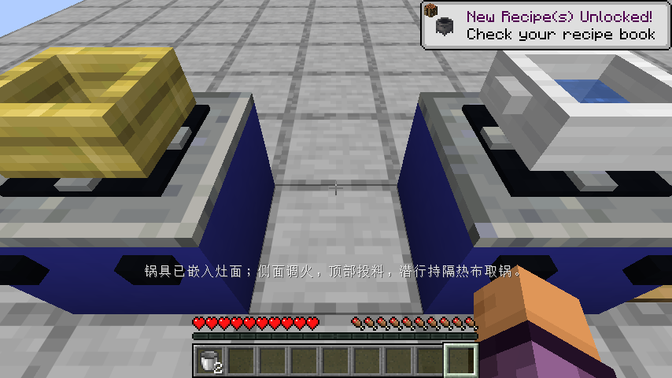
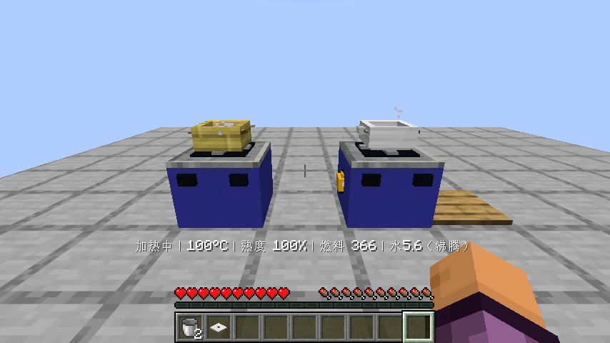
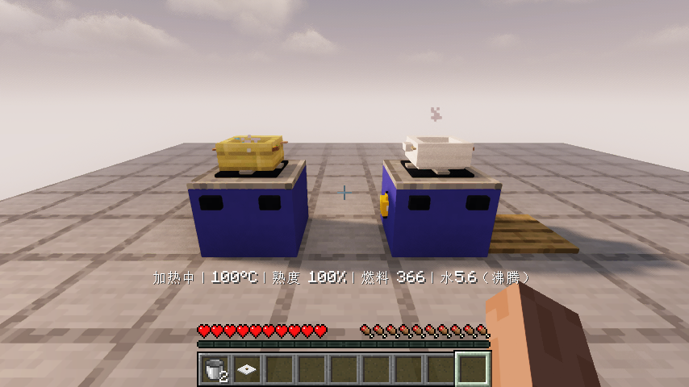
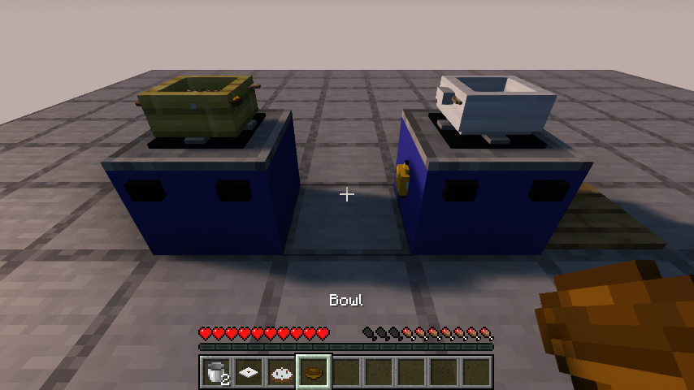

# 0.1.4：锅内的水、蒸汽和煮蒸炖步骤

Minecraft Java 26.1.2 / Fabric Loader 0.19.2 / Fabric API 0.149.1+26.1.2。移走旧模组JAR，只安装本版并保留对应Fabric API。

## 水与锅盖

- 加水按现有水量和锅的热量混合降温，满锅不能通过反复加水生成水或无限降温；水会缓冲新食材带来的降温。
- 有水时温度不超过100°C，升温后逐渐蒸发；盖锅减少蒸发。水烧干会停止水煮并可能焦化，加水不能洗掉已经烧焦的状态。
- 蒸菜需要有水、盖子和至少90°C的蒸汽条件；开盖会暂停继续蒸熟。空手点锅具顶部即可取回已有盖子，无需拿另一只盖子才能开盖。
- 原版水面动画、染色、蒸汽和水泡复用于锅内显示；水面随余量变化，提示区分无水、加热中、微沸、沸腾。
- 下料温度判定与显示的整数温度一致，避免看到110°C却被判为未预热。

## 八道菜的新增步骤

| 菜 | 关键步骤 |
| --- | --- |
| 姜葱蒸鱼 | 姜切片、葱切块或丝；有水盖锅蒸熟，各份有至少15秒盖锅微沸记录，全部熟透后淋酱油 |
| 白灼虾 | 姜片先下；有足够水且显示至少95°C沸腾时再放虾，不能冷水先下虾再补等候 |
| 蒸河蟹 | 姜片、水、盖锅微沸至少15秒，蒸至每份熟透，配醋 |
| 菌菇汤 | 菌菇切片或块，加水加盐煮熟 |
| 番茄蛋汤 | 番茄切片或块，先煮到至少五成熟再下蛋；最后的蛋保留自己的熟度 |
| 萝卜炖肉 | 肉和胡萝卜切块、姜切片；先炖肉到至少三成半熟，再下胡萝卜，盖锅微沸至少15秒 |
| 土豆炖牛肉 | 牛肉、土豆切块；牛肉先到至少三成半熟，再放土豆和洋葱，盖锅微沸至少15秒 |
| 南瓜浓汤 | 南瓜切块先煮至至少八成熟，再倒奶继续加热，奶桶保留 |

这些数值服务于可预测的游戏操作。已有四道煎炒菜规则保留，本版共12道菜有已实现的独特步骤，其余17道仍按有限待办继续制作。

南瓜等可处理的原版方块物品现在能进入砧板和锅具，不会被误摆在设备上方；煤块也能通过正常右键加入燃料口。开盖、投料、供热、盛菜仍以世界内操作为主。

实机补查还修复了潜行持刀切换切法、潜行持隔热布搬锅的入口：此前原版潜行操作会跳过方块交互，只测试设备内部方法未暴露这一问题。本版验证真正玩家输入，并检查切出的姜片和整锅搬运结果。蒸汽改用更小的原版白烟，避免遮住食材。

## 实际验收范围

继续回归创造分类、工作台合成、煤炉与气罐煎鸡肉、管网供气、从生米做炒饭并食用、整世界关闭重开。

本版新增实际客户端流程：放置两个气灶、汤锅、蒸笼和砧板；加水并查看水面；切姜片、葱和番茄；盖锅蒸鱼，同时先煮番茄再下生蛋；正常等待熟透后淋酱油、开盖、盛菜、吃鱼、关火；实际关闭并重开同一世界，核对鱼和汤的剩余份数、盖锅过程、水量与精确气量。

原版与 Iris 1.11.4 + Sodium 0.9.2 + MakeUp Ultra Fast 9.6 分别运行。原材料由测试提供，做菜过程使用正常客户端交互和正常游戏刻，未用设置熟度代替做菜；这不代替无作弊获取全部材料的最终验收。

33项单元测试、29项自定义服务端游戏测试及原版空测试通过。单元测试覆盖八道菜的正反例、水温混合、无盖不蒸熟、烧干不能靠加水消焦、沸水下虾、出锅酱油、肉先炖和整数温度边界。服务端游戏测试补查方块食材入锅、煤块装燃料、水桶降温返桶、空手开盖和过程保存。详细结果及发布文件摘要见 [验证记录](verification/0.1.4.json)。

光影兼容结论限于上面的实测组合，不表示全部光影包的特殊水材质/PBR规则均适配。测试光影包的非致命 `fixedTaaCorrection` 警告仍记录在案；未修改或打包分发光影、Iris或Sodium。

## 后续内容

当前汤锅仍按整批保存水量，逐份盛出时的扣水与剩余体积显示列入下一轮；蒸笼底水不应随夹走食物扣除。其余17道菜、翻面与半成品要求，独立原料/菜肴/生物美术，农牧生态、九类建筑、职业订单、宴席收藏、无作弊闭环和双客户端并发继续实施。注册条目和本次做菜测试不代表完整设计已经全部完成。
