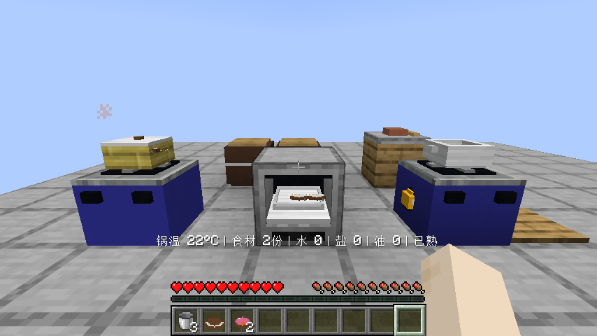
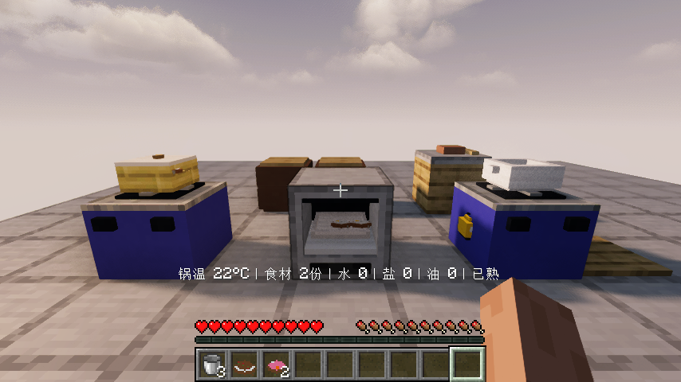
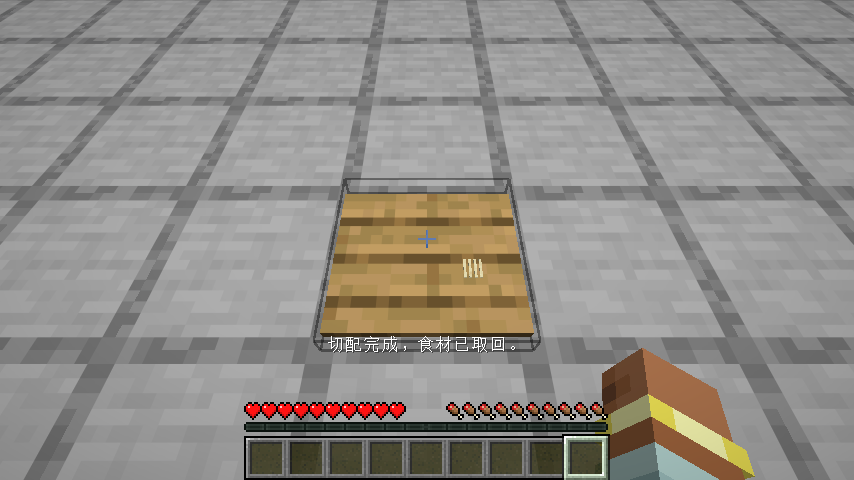
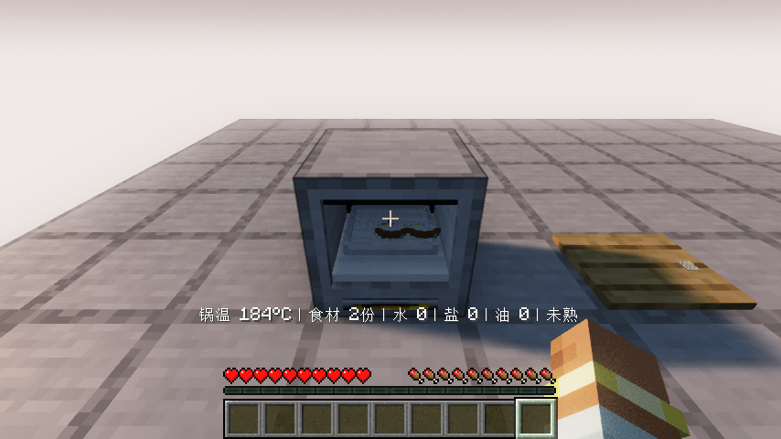
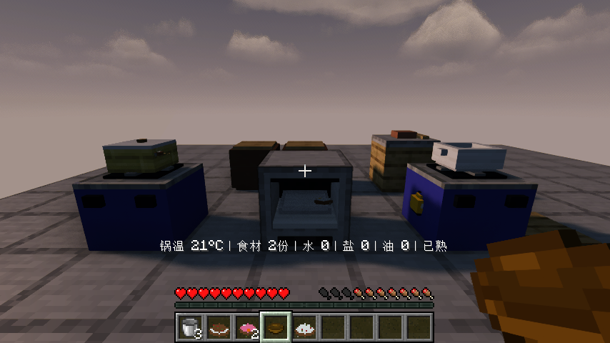

# 0.1.5：主食、擀切包馅与烤炉

Minecraft Java 26.1.2 / Fabric Loader 0.19.2 / Fabric API 0.149.1+26.1.2。原版与Iris玩法、最终素材检查通过；发布文件核对见文末记录。

## 七道主食的区别

| 菜 | 实际要求 |
| --- | --- |
| 米饭 | 下米时1–3份水；煮沸后小火、加盖至少10秒并熟透。用水壶量水，2碗 |
| 白粥 | 下米时至少4份水，炖煮软化到140%，搅拌至少2次，保留至少1份水，3碗 |
| 手擀汤面 | 面粉与水在调理台成团；面团在砧板用擀面杖擀开，再用切丝刀法切成面条；白菜切块或丝，加水盐煮熟，2碗 |
| 猪肉白菜饺子 | 面团擀开，猪肉剁碎，白菜切丝或剁碎；调理台持擀面杖包馅，得到生饺子再煮或加盖蒸熟，2份 |
| 馒头 | 面团与引子在发酵缸密封120秒，取出发酵面团；蒸笼有水且加盖蒸熟，有至少15秒盖锅记录，2份 |
| 家常面包 | 发酵面团加糖，烤盘装入烤炉；至少140°C烘烤15秒且熟透，2份 |
| 苹果派 | 面团擀开、苹果切片、加糖，调理台持擀面杖包馅；生派装入烤炉中的烤盘，烘烤熟透且记录至少15秒高温，3份 |

温度、熟度和时间是明确的游戏规则，按游戏时间压缩。仅把原料放在一起不能跳过擀皮、肉末、切菜、包制与发酵。发酵引子可以续种，成团、切面、包馅均保留世界内操作。

擀开的面皮和切好的面条使用原版砂岩材质的清楚立体模型，以形状区分。烤炉有封闭炉体与可见的烘烤腔，烤盘嵌入腔内，底部引用原版熔炉燃烧面，热食物使用原版烟粒子；可潜行持隔热布取出整盘并保留成品与烤制记录。

## 水量、餐具与剩余食物

- 煮、炖每盛一份扣除对应比例的水；水面和可见食物数量随剩余份数减少。份数从首次盛菜锁定，不能改份数重复产出。
- 蒸笼底水不随夹走蒸菜扣除，最后一份取出后仍保留剩水。烧水本身仍有蒸发，盖子减少蒸发。
- 没有锅具的裸灶、烤盘和烤炉不能装水，拒绝时不扣水桶。
- 散装取回的熟米是真正熟米物品，并移除餐具返还组件；倒入炒锅不会凭空返碗。正常盛出的饭保留原来的碗盘，吃完或倒料才返还。
- 加工消耗装碗米饭会返还原碗；破坏已分餐锅具掉落的散装剩饭菜不额外附送餐具。
- 蒸菜缺盖时准星提示直接说明不会继续蒸熟；灶台提示增加小火／中火／大火，方便按食谱调火。

## 验收记录

44项单元测试、36项自定义服务端游戏测试及原版空测试已通过。覆盖七道菜的正反例、低火记录、错切法拦截、包馅、烤盘安装搬运、水量分餐、旧记录范围约束与餐具守恒。

原版与实际启用Iris 1.11.4 + Sodium 0.9.2 + MakeUp Ultra Fast 9.6的客户端均完成：分类、合成、煤气煎鸡、炒饭与蒸鱼煮汤回归；从面粉做面团、擀切面条、煮面；两缸实际密封发酵、烤面包、蒸馒头，食用、关闭重开同一世界，以及搬走烤盘再装回。面包先熟就关烤炉，馒头继续蒸至自己的熟度达到要求。饺子与苹果派的加工正反例由服务端游戏测试覆盖，未宣称逐菜完成无作弊生存获取验收。

最终素材另跑原版/Iris短流程：实际擀开面皮、切成面条、给装有食材的烤炉加煤，检查形状、材质和炉口燃烧。此近景检查临时关闭世界文字以看清形状，完整做菜流程保留默认设置；仍需改进小食材被文字遮挡的问题。原版原生贴图引用36种已逐个对照游戏资源确认。

测试原料由测试提供，所有切配、发酵、加热、装盘、食用、关闭重开与搬运使用正常客户端交互或正常游戏时间，不以设置熟度代替实际做菜。完整无作弊获取、更多生态和多人场景仍在后续范围。

详细范围与文件摘要见 [验证记录](verification/0.1.5.json)。兼容结论限于上述组合，光影包的非致命fixedTaaCorrection警告仍记录在案。

## 后续范围

白粥已有软化要求，准星普通熟度仍会先到100%，独立软化进度提示列入下一轮；锅内名称文字对小食材的遮挡和更多成品外观继续改进。还有10道菜的独特工序、品质与翻面、更多清楚的原料菜肴和动物外观、农牧生态、九类独立建筑、职业订单、宴席收藏、生存获取闭环和双客户端并发。现有注册项或本轮自动测试不等于完整设计已经完成。

## 发布核对

已从GitHub资产接口实际下载 smoke-kitchen-0.1.5.jar（652721字节），与本地构建和服务器摘要一致。移出旧版JAR，保留对应Fabric API。

SHA256：b36e3ad25dcbfce2a7bab44c0f4b17332684c718e884023a1cd9a2d622ca4e47
