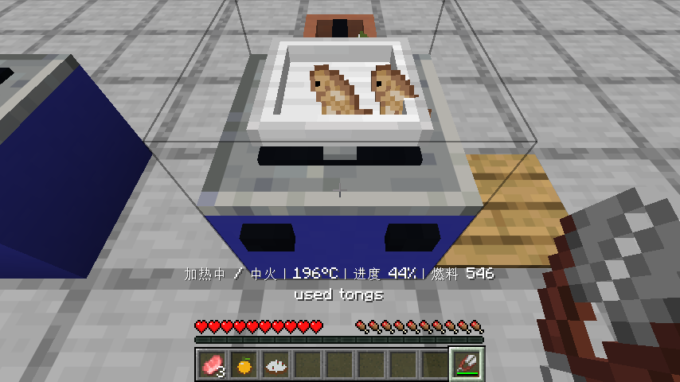
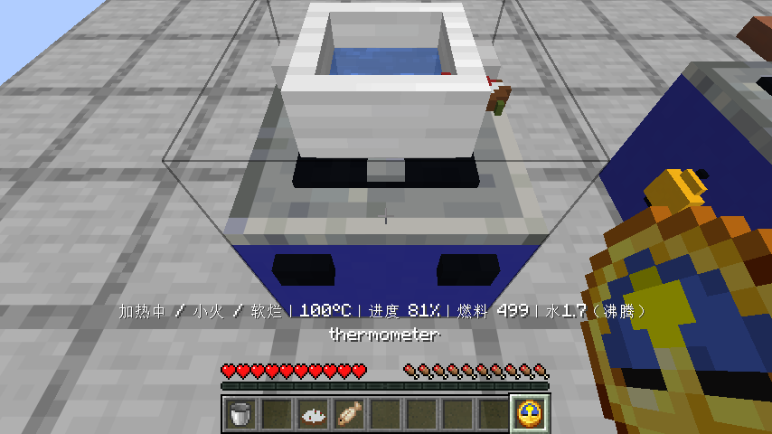
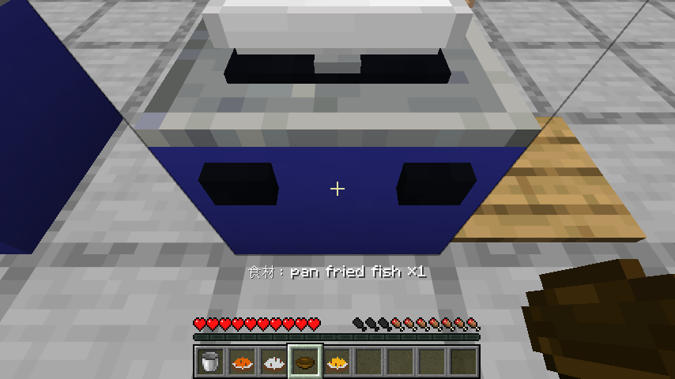
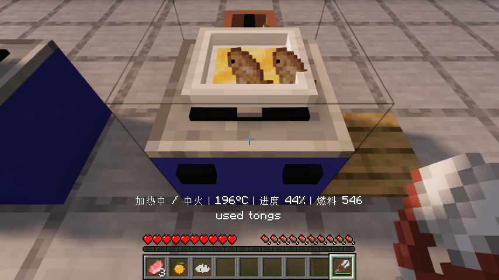
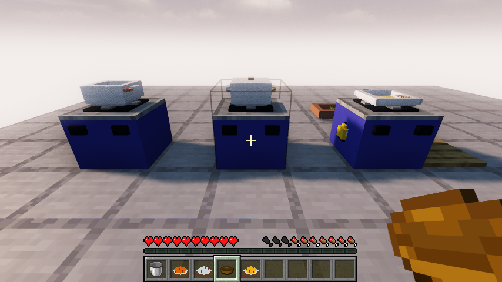
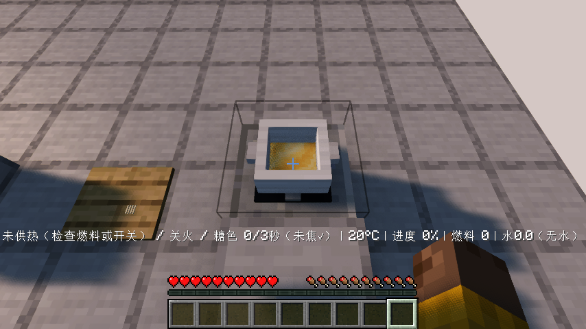
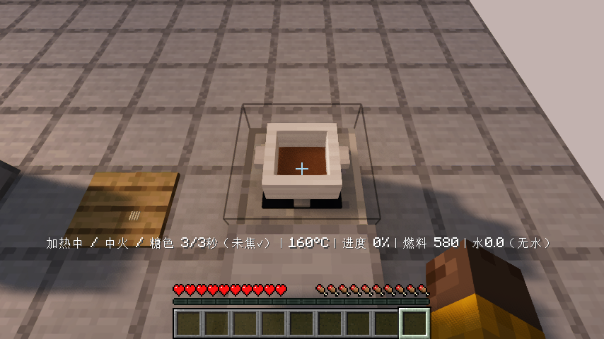
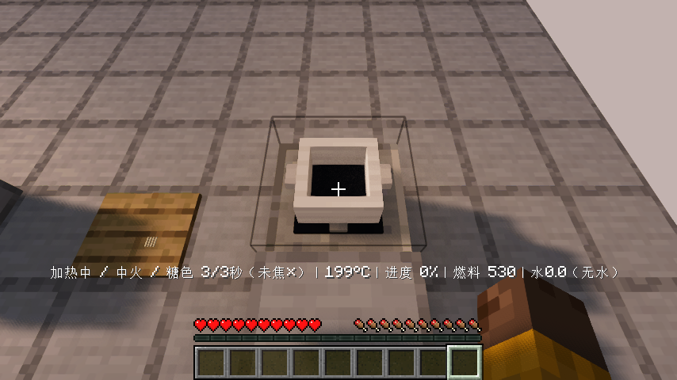

# 0.1.6：翻面、炒糖色与其余十道菜

Minecraft Java 26.1.2 / Fabric Loader 0.19.2 / Fabric API 0.149.1+26.1.2。每道菜按明确的游戏时间与温度规则制作，时间经过压缩，不把真实厨房等待时长原样搬进游戏。

## 本版工序

| 菜 | 实际要求 |
| --- | --- |
| 蒜蓉青菜 | 蒜剁碎，至少100°C热油先炒蒜，再放切块或切丝白菜，最后投料后翻炒3次 |
| 葱花煎蛋 | 两份蛋与切碎葱冷锅拌匀2次，再加热；凝固后翻面，另一面继续加热 |
| 煎鱼 | 两份鱼下锅时有油且至少110°C，盐与胡椒粉；一面至少三成半熟后翻面，继续煎另一面 |
| 红烧肉 | 猪肉切块、姜切片；无水油糖锅145–185°C炒糖色3秒，再下肉和姜，加水酱油，盖锅15秒、小火10秒，继续炖至软烂 |
| 烧茄子 | 茄子切块、蒜剁碎；热油先炒蒜再下茄子，至少七成熟后加酱油与糖，翻炒3次 |
| 凉拌黄瓜 | 两份黄瓜切片或块、蒜剁碎，芝麻油、盐、醋，拌3次；当前锅内全程低于60°C |
| 泡菜 | 白菜切丝、辣椒切片或块、蒜剁碎，加水与两份盐；腌菜坛密封1200游戏秒，再开盖取出 |
| 肉串 | 三份切块猪肉与切好的洋葱，在调理台用三根原版木棍、长筷子组串；加油盐孜然，至少140°C干烤15秒，凝固后翻面并继续烤 |
| 蜜汁烤鸭 | 三份鸭肉先用蜂蜜酱油在60°C以下腌10秒，再入炉；至少140°C烤15秒，五成熟后再刷一次蜂蜜，盐调味 |
| 烤土豆 | 三份土豆切片或块，加油盐，入炉至少140°C烤15秒，继续烤至软烂 |

具体份数、锅具与操作可在游戏内厨师食谱查看。蜂蜜瓶使用后返还玻璃瓶。指定胡椒、孜然、芝麻油需要实际对应调料，不能用任意香料替代。

翻面由锅铲、夹子或长筷子触发，食材会在锅面翻转。冷锅反复点击不能提前攒好翻面条件；另一面要继续受热。红烧肉先加水再加糖不算炒糖色，持续超过185°C烧坏的糖也不算。腌菜坛不能空放攒进度后瞬间完成新材料；重新加料重新计时，密封时拒绝投料且不吞物品。

## 看得见的状态

- 白粥、红烧肉和烤土豆按照自己的软烂目标显示0–100%进度。普通熟度已满但尚不软烂时，持碗不会提前锁成普通菜，也不会消耗碗；提示继续加热。
- 油面、棕色糖色和烧黑的糖用原版材质及正常模型管线显示；动画水面仍使用原版水材质。颜色跟随实际锅内记录。
- 移除锅、砧板、餐盘上遮挡小食材的悬浮文字。潜行看设备显示食材内容；分餐后显示剩余成品与份数。
- 煎鱼与烤土豆成品继承原版熟鳕鱼和烤马铃薯图标。其余仍需改进的菜肴、原料与动物素材保留在有限待办，不宣称全部美术已完成。

## 验收范围

60项单元测试、43项自定义服务端游戏测试及1项原版空测试通过。十道菜的正确和错误工序均有覆盖；腌菜坛还实际经过24100个服务端游戏刻验证密封腌制与取出，未直接设置熟度。

原版客户端完整流程已经通过：实际切猪肉、姜、黄瓜、蒜，凉拌装盘；预热煎鱼、翻面、继续加热；炒糖色再下肉、加水盖锅小火炖；白粥普通熟透后盛菜被拦截，再炖到软烂成功盛出；吃鱼、关闭重开同一世界，检查剩余菜名份数、精确气量、水量与过程记录。旧版分类、工作台合成、煤炉与燃气管路、炒饭、蒸鱼、煮汤、擀面、发酵、蒸馒头、烤面包和搬运流程一同回归。

油面材质是在上述原版完整流程之后补充，另跑原版近景检查；最终Iris完整流程与画面检查也已通过；另补高处近景以看清油面。发布摘要见验证记录。兼容范围限于实际测试的Iris 1.11.4 + Sodium 0.9.2 + MakeUp Ultra Fast 9.6组合。

测试提供初始原料和平台，切配、投料、供热、翻面、装盘、食用、存档均使用真实客户端交互与正常游戏时间。本版没有逐道完成29道菜的无作弊生存获取验收，也没有把单元规则测试冒充逐菜实机检查。

详细结果与发布文件摘要见[验证记录](verification/0.1.6.json)。更多生态、独立建筑、经营、正式美术和多人验收继续按[有限待办](WORK-QUEUE.md)推进。
