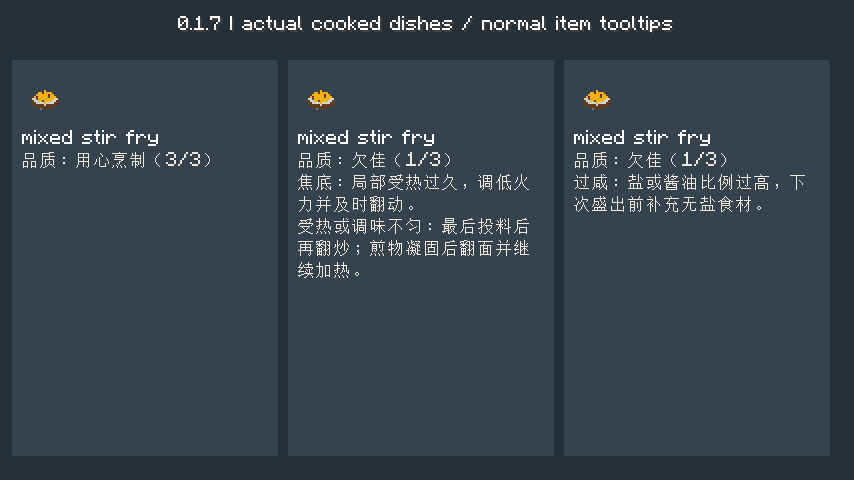
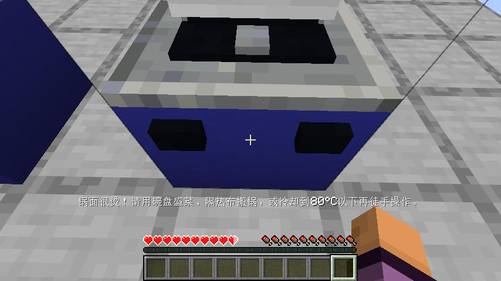
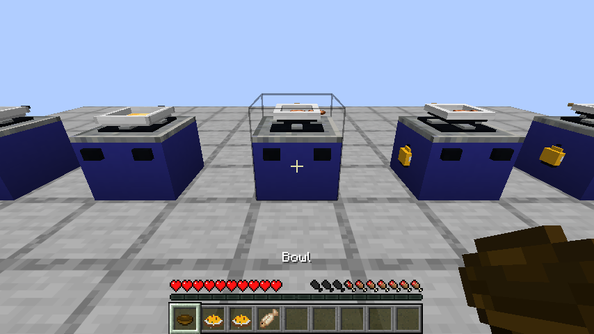
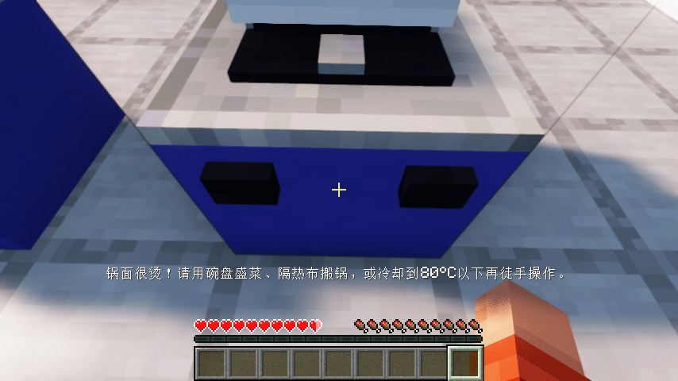
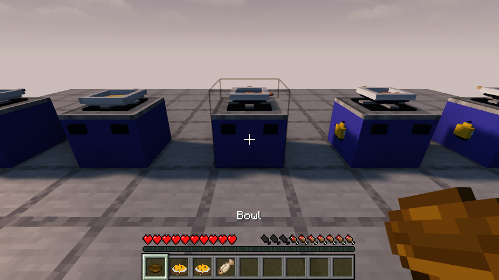

# 0.1.7：看得懂的品质与半成品回锅

Minecraft Java 26.1.2 / Fabric Loader 0.19.2 / Fabric API 0.149.1+26.1.2。

## 品质有原因，也影响食用

盛出的菜保留品质与原因，普通物品提示会显示“用心烹制、家常、欠佳或失败”，并说明过咸、偏重、偏淡、焦底、过熟、未翻匀或夹生等具体问题。最后加料后必须重新翻炒，不能用之前空锅的点击抵扣。煎物凝固后翻面、继续加热另一面，才算均匀受热。

白饭、白粥、纯面团主食、发酵面团和派不强制盐或酱油，不会仅因没放咸味调料就降低品质。加入蔬菜等做成咸味汤面后仍检查调味；给主食加过量盐也仍会影响品质。

用心烹制保留原本饥饿值和饱和度；家常菜保留饥饿值、略降低饱和度；欠佳与失败食物的饥饿值为基础值的60%向下取整、最低1，饱和度进一步降低。未熟仍不能正常盛出，焦黑仍是独立食物。变得不新鲜时降低品质与食用收益，保留原来的制作时间，不能靠状态变换刷新保鲜时钟。

## 半成品自身状态跟着走

- 同一食材身份的散装食材取出、回锅，会保留熟度、焦化、切法、已翻面与翻面时熟度、腌制秒数、盖锅及小火记录、糖色记录和经历过的最高温度。
- 原版烹饪配方生成的熟肉也会补回真实切法。已加热蔬菜不能靠换到冷碗里抹去温度历史，再冒充全程冷拌。
- 新锅重新记录实际下料温度与本锅里已有哪些食材。上一口锅的邻近食材不能替新菜谱作证；原锅的水、油、盐等也不会凭空附在散装食材上转移。
- 取走最后一份食材后清除空锅的食材温度历史。整锅搬运仍会保留完整的锅内液体、调味与做法；需要继续原来整锅菜的全部工序时，使用隔热布整锅搬走。
- 0.1.6完整锅存档的历史可保守迁入每份食材；更早已丢失的散装历史无法凭空重建，不宣称恢复了不存在的旧记录。

## 可关闭的烫伤和提示

游戏实例的`config/smoke-kitchen.json`增加两个开关：`burns`默认false，`detailedHints`默认true，修改后重启游戏或服务器。

启用`burns`后，徒手点80°C及以上的锅面会受到原版热地面伤害并被提示，食物不被取走。可持碗盘盛菜、隔热布搬锅，或等锅冷却；侧面旋钮仍可调火，烤炉控制不按裸锅面处理。关闭后保留原来的徒手取料操作。原版伤害冷却、盔甲等规则仍适用。

关闭`detailedHints`会关闭自动准星详情与投料菜谱建议；温度计、食谱书、直接操作反馈、物品品质提示和实际烹饪仍可用。腐败仍由已有`spoilage`开关控制。

## 验证范围

70项单元测试、49项自定义服务端游戏测试及1项原版空测试通过，覆盖品质差异、转移历史、错锅顺序隔离、旧温度记录约束、不新鲜状态不刷新时钟与可选规则。

原版客户端实际做了三锅同样的生鸡肉：适量盐及时翻炒、忘记翻动、过量盐但正常翻炒，熟透后分别关火装盘；正常菜3/3，忘翻菜因焦底与不匀1/3，过盐菜因咸1/3。随后启用烫伤徒手点热锅实际扣血，食物保留；关闭烫伤和自动详情后继续装盘、将翻过面的半熟鱼取到另一口冷锅，再加热得到真正原版熟鳕鱼，吃菜、关闭并重开世界。剩余份数、气量、品质原因和鱼的记录均保留。另回归创造分类、工作台合成、煤炉与气灶熟鸡和管网供气。

Iris全部七组流程与画面已经通过；最后补充的主食例外另在原版和Iris各跑一次完整煎鱼、红烧肉、凉拌与白粥流程，实际盛出的无盐白粥品质3/3，保存恢复通过。此次只改口味判断，不改供热和工序；具体范围与发布摘要见[验证记录](verification/0.1.7.json)。兼容范围限于实际验证的Iris 1.11.4 + Sodium 0.9.2 + MakeUp Ultra Fast 9.6，既有非致命fixedTaaCorrection光影包警告仍记录。

测试提供原料与平台；品质对照页读取实际做出的菜和普通物品提示，只是测试展示页，不是新增生产界面。第一餐获取依赖已整理到[获取路线](FIRST-MEAL-ROUTE.md)，完整无作弊生存验收仍未完成。其他生态、美术、建筑与经营待办继续保留。
