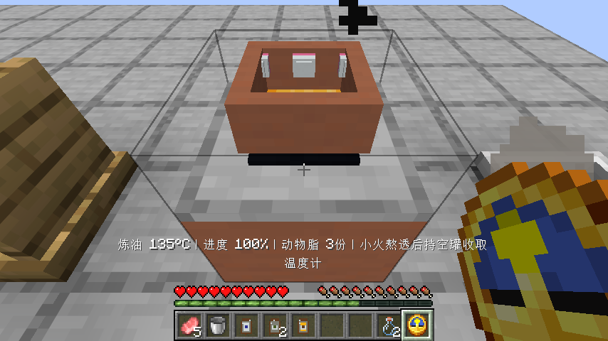
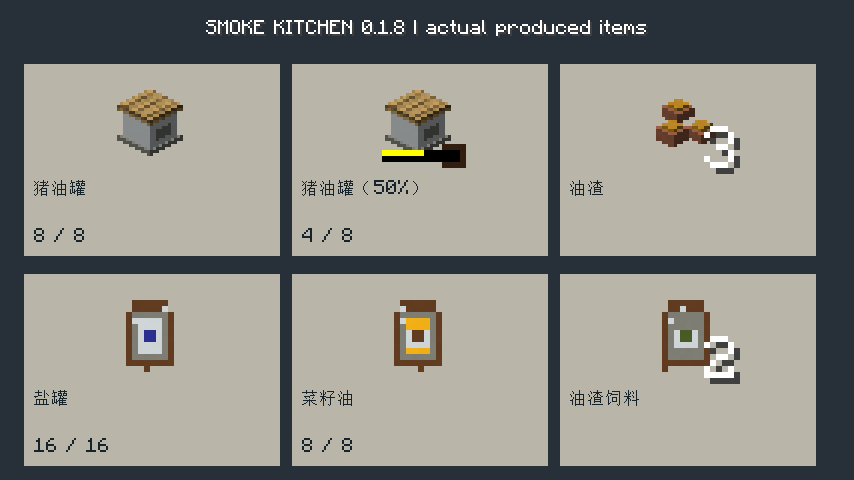
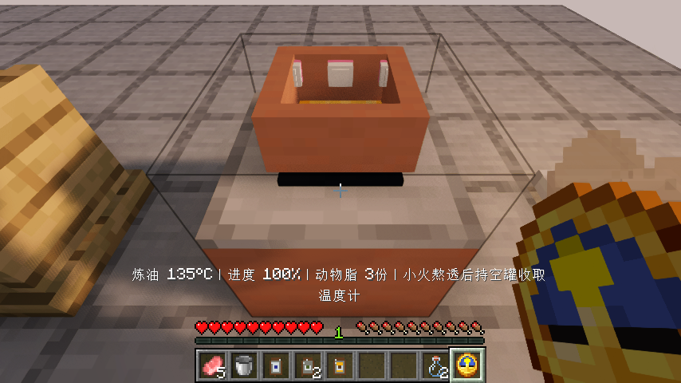
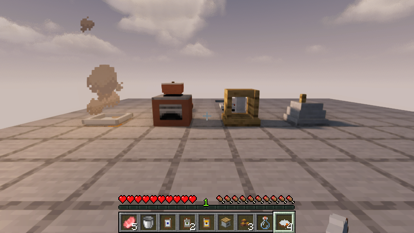
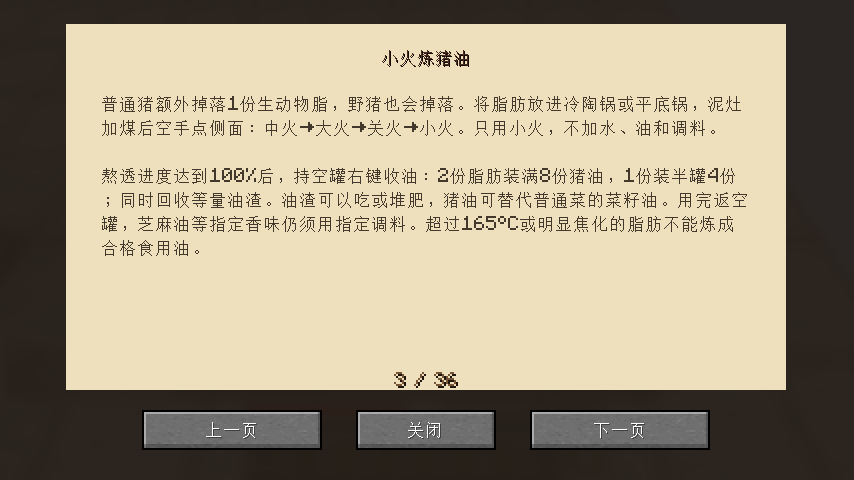

# 0.1.8：早期食用油与获取流程

Minecraft Java 26.1.2 / Fabric Loader 0.19.2 / Fabric API 0.149.1+26.1.2。原版与光影流程验收通过，发布核对见本文末尾。

## 小火炼猪油

普通猪沿用原版猪肉掉落，额外掉落一份生动物脂；已有野猪也提供动物脂。在冷陶锅、汤锅、炒锅或平底锅里只放动物脂，不加水、油和调味料，小火熬到进度100%，持空罐收取。两份脂肪装满8次用量的猪油罐，一份装半罐4次用量，同时回收等量可食用或堆肥的油渣。猪油用完返空罐，精确余量随物品和存档保留。猪油可满足普通食用油要求，不能替代凉拌菜指定的芝麻香油。

加煤默认中火；空手点灶台侧面依次为大火、关火、小火。炼油从冷锅用小火，经历超过165°C或明显焦化的脂肪不能变回合格食用油。未熬透、加水或混入其他原料时不消耗空罐。普通食物仍遵守原来的水量与熟度规则，炼油例外只用于纯脂肪。

生脂肪、猪油罐和油渣采用各自的立体形状，运行时引用原版材质；不是一组换色工具图标。稻谷改为清楚的原版麦穗图标，必须经手磨脱壳后才能作为米入锅，不能直接煮带壳稻谷跳过加工。

## 盐、水壶和加工收取

- 加工产物优先合并已有堆叠，再使用空位；连续研磨四份盐矿石后，十六份盐晶能合在一堆取出。
- 水壶可逐份给调理台、发酵缸、腌菜缸和蒸发盘加普通水，用完保留空壶；有盐水的盘不会被普通水壶混成盐水。
- 盐水蒸发盘复用锅具的热源判定，支持燃气灶，以及正在燃烧的原版篝火、熔炉、烟熏炉和高炉。六份盐水加热120游戏秒产四份盐晶。
- 普通水不会产盐。蒸发盘误加整桶水后，可持空桶取回；排空和重新加料重计加工时间。
- 散装生米煮成熟饭再投入新锅时，熟度、焦化、小火、盖锅和最高温度历史继续保留，新锅的投料顺序重新记录；散装熟饭不凭空增加碗。
- 食谱增加炼油、容器、海盐和首个引子的获取说明。压榨机保留原版活塞成本，炼猪油提供不依赖红石的早期用油路线；植物油仍有和平种植获取路线。

## 验证范围

74项单元测试、56项自定义服务端游戏测试及1项原版空测试通过。原版客户端完成新获取流程、全部309条目的创造分类、工作台合成、煤炉/气灶和管路、面条、实际面团发酵、蒸馒头、烤面包、食用、保存重开与烤盘搬运；实际打开手中食谱书，用翻页按钮查看新增教程并检查排版。

获取流程实际攻击普通猪取得动物脂，用冷陶锅、小火和真实等待熬油，取出一满罐、一半罐和三份油渣；半罐四次加油后返空罐。实际采掘两块盐矿并磨盐装罐，海洋取盐水、原版篝火蒸发，压榨菜籽，水壶八次量水，稻谷脱壳得到米和谷壳，低火加盖把米真正煮熟，再把散装熟饭投到另一口冷炒锅。关闭并重开世界后，精确猪油用量、容器、产物、液体及熟饭历史均通过服务端断言。

首个发酵引子由实际密封缸经过24100个服务端游戏刻培养，产2引子并只返1碗；该项用加速运行的无界面服务端游戏时钟验证，没有直接设置加工进度，尚未作为二十分钟客户端从零获取示范。

Iris全部八组客户端流程与截图检查通过，包括新获取、品质与半成品转移、煎鱼/红烧肉/白粥、创造/合成/燃气、蛋炒饭、蒸鱼与汤、面食蒸烤、材质及教程翻页。实际组合为Iris 1.11.4 + Sodium 0.9.2 + MakeUp Ultra Fast 9.6，运行记录确认实际启用光影；不代表所有光影包的专用发光/PBR规则均适配。

原料、矿块、无AI的猪和平台由测试场景提供，挖掘、攻击、投料、加热和收取均使用正常玩家输入，没有生成熟度或直接填加工进度。本版不把这些场景当成自然世界从零生存验收。产品对照页展示实际产物及剩余用量，是测试展示页，不是新增的游戏界面。详细范围见[验证记录](verification/0.1.8.json)。

需要保留整锅调味时，仍用隔热布搬整锅；散装食材的调味附着与复热品质继续列为待验收内容。野生作物、种植生态、无起始物资第一餐、设备功能逐项验收、独立动物与建筑、职业经营、多人和长期保存等有限待办继续保留。见[待办](WORK-QUEUE.md)。

## 发布核对

本地原版与Iris流程、截图目视和构建均已通过，等待上传并从GitHub实际下载核对。
