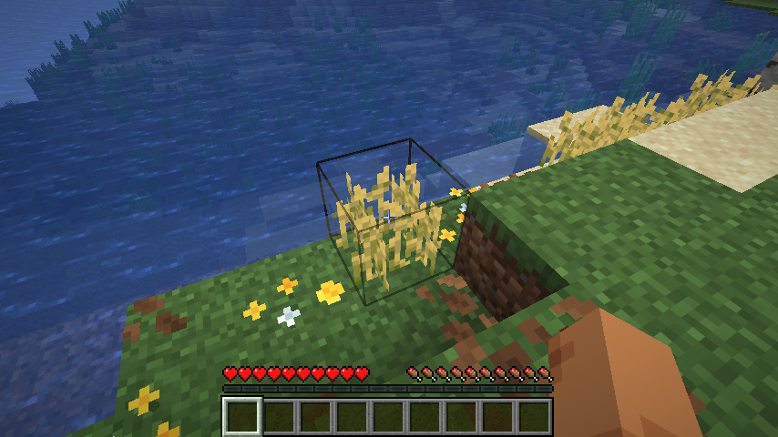
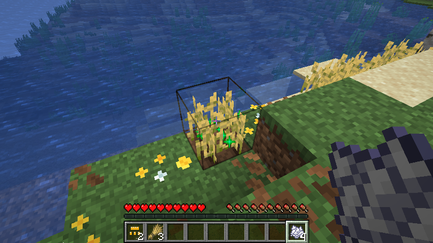
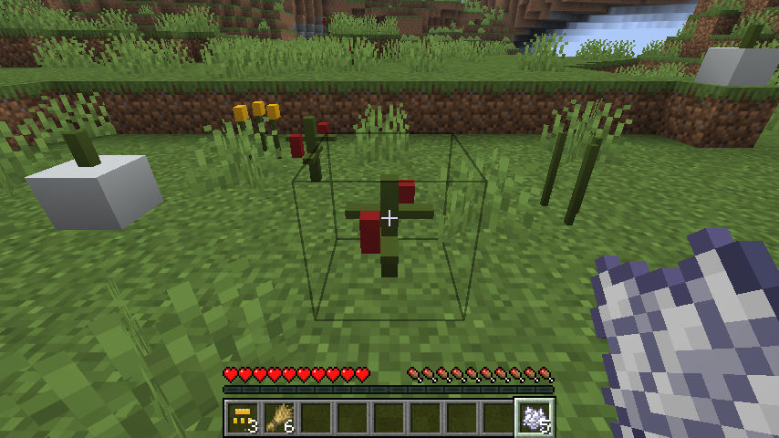
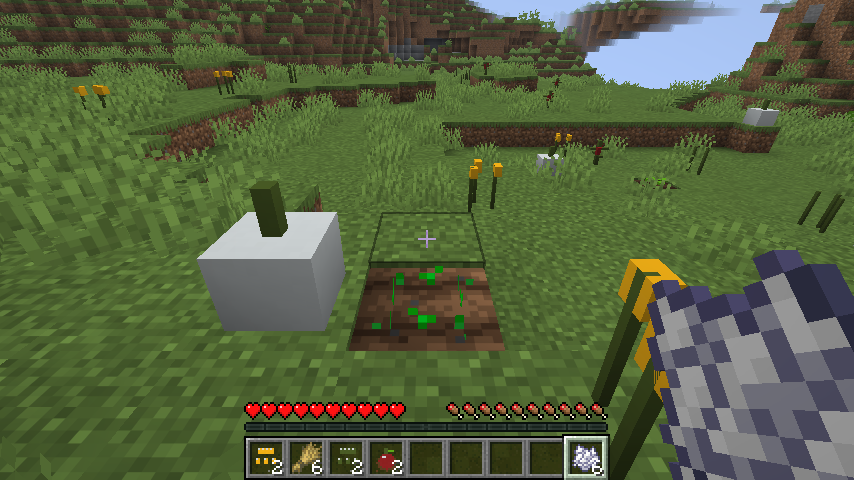
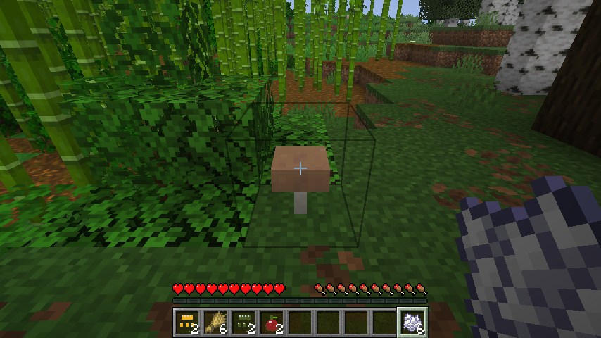
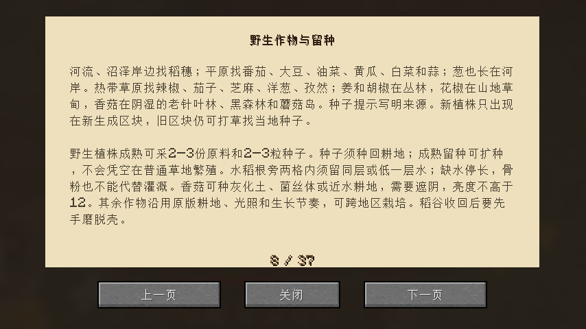
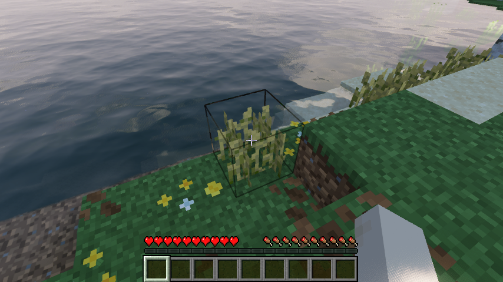
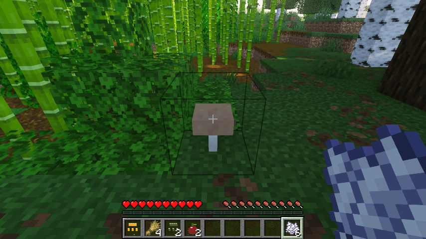

# 0.1.9：地区野生作物、灌溉与留种

Minecraft Java 26.1.2 / Fabric Loader 0.19.2 / Fabric API 0.149.1+26.1.2。原版与Iris的最终流程与画面验证已通过；发布核对见本文末尾。

## 去哪里找种子

17种作物有各自的地区野生植株，不再依赖所有草丛统一抽取任意种子。野生植株生长在原有地貌上，不把河岸或森林整片改成耕地。成熟野生植株和耕地作物均产2–3份原料与2–3粒种子，能留种并扩种；未成熟作物只返1粒种子。玩家播下的种子是耕地作物，不能用它在草地上复制成熟野生植株。

| 地区 | 野生原料 |
| --- | --- |
| 河流、沼泽岸边 | 稻谷、葱；稻谷只在根旁两格内有水的位置出现，河流样本可延伸至紧邻河岸的相邻生物群系 |
| 平原、向日葵平原 | 番茄、大豆、油菜、黄瓜、白菜、蒜；平原也有葱 |
| 热带草原、稀疏丛林 | 辣椒、茄子；芝麻和洋葱在热带草原 |
| 热带草原、沙漠边缘 | 孜然 |
| 丛林、竹林及稀疏丛林 | 姜、胡椒 |
| 山地草甸、风袭山林 | 花椒 |
| 老针叶林、黑森林、蘑菇岛的树荫或菌盖下 | 香菇 |

野生植株只进入新生成区块；旧区块仍可通过打草获取当地种子、探索已有农舍留种。每粒种子的提示写明地区与种植条件，食谱增加“野生作物与留种”页。修复种子误用方块名称的问题，现在能明确看到“稻谷种子”等物品名称。

## 原版种植与环境

继续继承原版CropBlock，保留耕地、普通光照、骨粉和随机生长。成熟留种数量支持扩种；补上原版maintains_farmland标签，已种作物的干耕地不会被当成空地退回泥土。

- 野生水稻也支持红树林的原版泥巴地面，玩家播种仍需耕地；植株根旁水平两格内的同层或低一层须有水。缺水暂停生长，骨粉也不生效且不消耗；保留原来的苗和阶段，补水后可继续。
- 香菇种在灰化土、菌丝体或近水耕地，需要上方遮阴且实际亮度不高于12。野生香菇在对应湿润树林的遮挡下生成；挪走遮挡不会瞬间删除已成熟的植株。栽培不要求强制四季或酸碱度。
- 其余作物可跨地区栽培，野生来源地区不会限制玩家把种子带回家种。
- 农家院田地保证6株水稻，中央留真实灌溉渠，田院上方开放，避免把稻田盖在不见光的屋内。九种建筑的独立蓝图仍待完成。

水稻植株直接继承原版小麦的8个生长阶段，香菇引用原版大型蘑菇的菌盖、菌柄材质；没有新增模糊图片或复制第三方贴图。原版47项贴图引用与31个模型父项均已逐项核对存在。其余作物模型与动物外观的后续改进仍保留在有限待办。

## 实际验证

74项单元测试、61项自定义服务端游戏测试与1项原版空测试通过。新增检查包含红树林泥巴上的野生稻谷、缺水随机生长与骨粉、补水恢复、阴湿香菇、自然草地与耕地状态、成熟掉落扩种、17种地区覆盖、原版耕地标签以及农家院露天灌溉。

详细范围见[验证记录](verification/0.1.9.json)。原版客户端在正常自然地形、种子1中寻找并采收真正生成的稻谷、番茄和香菇；没有放置测试植株或注入收获物。实际锄地、播下采回的种子，用原版骨粉使有水稻苗成熟并再次采种。另在自然旱地种稻，连续三次用骨粉，苗保持0阶段、6份骨粉未减少；不能靠骨粉绕过灌溉。实际关世界再打开，耕地/野生身份、生长阶段、暂停的旱稻和背包收获物均保留。打开手持食谱并按按钮翻到新增教学页，目视核对排版与植株画面。

同时回归独立创造分类与全部309条目、工作台合成、低灶面锅具、煤与燃气实际做熟鸡肉、管路供气、面条/发酵/蒸馒头/烤面包、食用、容器和保存恢复。Iris 1.11.4 + Sodium 0.9.2 + MakeUp Ultra Fast 9.6下，同样三组完整客户端流程通过，运行断言与日志确认实际启用该光影包。本版没有重复跑其余未改动的五组客户端流程，不宣称全部光影包的PBR或专用动画映射已适配。

自然来源定位使用传送，测试提供木锄和骨粉。该场景验证自然生成及原版种植操作，不计入“无起始物资、无传送、无加速生长的完整生存第一餐”。那项验收仍明确未完成。专用稻田土方块、香料架支撑、酱油蒸煮过滤、米醋过滤、生物养殖/外观、独立建筑、经营、多人和长期保存仍见[有限待办](WORK-QUEUE.md)。

## 发布核对

尚未发布；待最终Iris验证与下载核对后填写。
